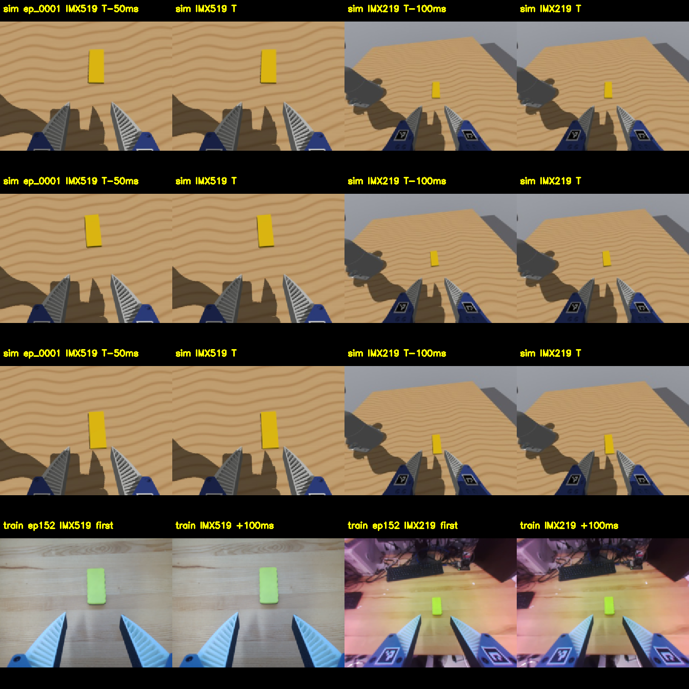

# 01_start_pose / 6: run_006 backs away in the sim, and the camera swap points at the sim IMX219

**Status:** done · **Date:** 2026-11-20 · **Who:** agent ·
**Plan ref:** sim_deploy/PLAN.md §6 "P3" table row G7 (and §10), DESIGN.md "P3/P4" -> "P3 results"

Part 6 of 6 of [01_start_pose](README.md). Earlier parts: [1_p_key_and_standins.md](1_p_key_and_standins.md),
[2_candidates_envelope.md](2_candidates_envelope.md), [3_early_failure_screen.md](3_early_failure_screen.md),
[4_gate_check.md](4_gate_check.md), [5_real_pc_handoff.md](5_real_pc_handoff.md). The hypothesis this part ends on is
tested in [02_camera_study](../02_camera_study/README.md).

## Question

From the P3 stand-in, does run_006 (PICK_TEST1, behavior prompting) start toward the eraser in the sim? If it does
not, which input makes it back away: the sim IMX519 image, the sim IMX219 image, or the gripper width?

## Why it matters for the real robot

- If the start pose were the cause, the real arm's `q_start_rad` would have to change. If the camera images are the
  cause, the start pose is not to blame, and the policy screen of [3_early_failure_screen.md](3_early_failure_screen.md)
  cannot rank start poses until the sim images are fixed.
- Whether the image problem is the **geometry** of the view (a real-world problem: the Franka mount vs the handheld)
  or only the sim's **appearance** (a sim-only problem) is not decided here. This part only finds which camera the
  policy rejects. [02_camera_study](../02_camera_study/README.md) tests geometry against appearance.

## Setup

| Item | Value |
|---|---|
| Repo / branch | `~/Capstone-main-sim`, `rnoro/main-sim` @ `3633fcb` (+ uncommitted `sim_deploy/`, `deployment/`); eval.yaml `git.sim_deploy` `3633fcb3b23a...-dirty` |
| Model | `sim_deploy/build/sim_rig/model.json` `model_sha256` `166a0649571a…` (P3/P4: base on the table, table top O z 0; current appearance: procedural table, directional lights, kit colours) |
| Home / start pose | `--home start`: PC `h`, then `p` to the **P3 stand-in** `q_start_rad [-0.6419329, 0.3706554, -0.1347388, -1.8275169, 0.5918946, 1.4884701, -1.6761742]` rad: TCP O (0.4385, -0.1641, 0.1618) m, tilt 49.51 deg, heading 92.36 deg ("pointing to the robot's left"), 16.18 cm above the table. **Not** the chosen pose `leftx55_t48_h16` (eval's `start_pose.yaml`, `eval.yaml home.start_pose`) |
| Eraser placement | `sim_deploy/scene/randomization_start.yaml` (`pick_eraser_start_v1`), seeded; per episode ahead 17.1 / 20.3 / 10.0 cm, left -2.6 / -1.7 / -2.2 cm, yaw -6.3 / -0.7 / -2.2 deg (episodes.jsonl `placement`) |
| Stations / overlays | `stations/control_sim.yaml` + `start_pose.yaml` merged into `sim_deploy/build/control_sim_start.merged.yaml`; no overlay (real v_max 0.25 m/s) |
| Policy / checkpoint | `PICK_TEST1/run_006_2026-11-18`, kind prompting (`umi_policy_dunetp`), dataset `pick1-v1` (30 demos), 60 epochs, `checkpoints/top1_epoch=0059-val_action_mse_error_all=0.0002007.ckpt` (2.59 GB) |
| Prompt | closed loop: `prompt_index 0` = `pi-2026-11-18_episode_000138` (561 steps); offline: the warm-up prompt, train-split index 14 = `pi-2026-11-18_episode_000153` (775 steps) |
| Inference settings | closed loop: bf16, 8 diffusion steps, `exec_h` 12, GPU (eval.yaml `station_policy`, `station_manager`; policy_deploy.log "precision: bf16", "diffusion steps: 8", "exec_h 12"). Offline: fp32 on the CPU, 8 steps (the script overrides device and precision) |
| Seeds / episodes | `--seed 0`, 3 episodes (seed keys [0, 0], [0, 1], [0, 2]) |
| Timeout | `--timeout 60` s |
| Sim-only settings | box min x 0.20 m, y -0.40 m, z -0.005 m; finger contact pairs; width offset 0.0; sim appearance (see [README conventions](../README.md)). `--tap` saves the policy's inputs and chunks |
| Training reference | `pi-2026-11-18_episode_000152` (dataset index 14 of `pick1-v1.zarr.zip`, data rows 8217-8806): its first IMX219 frames and the IMX519 frame at the second one, width 0.08677 m, in `sim_evals/_start_pose_sweep/p3/ep152_ref.npz` (15.7 MB, stays there) |

## Method

1. **Closed loop (G7).** `sim_deploy/run.sh` with the eval driver (`sim_deploy/eval`), 3 episodes from the P3
   stand-in. Measured: outcome and fault rule (`episodes.jsonl`, `metrics.json`), inference time and step margin
   (`metrics.json steps`), the TCP path at 20 Hz (`episodes/<n>/trace.json` `tcp_O_xyz_wxyz`), the first chunk
   (`session/*/manager/tap/ep_0001/chunk_1.npz` `chunk_eef_pos`, TCP frame: z = toward the fingertips). Pass (PLAN §6
   G7): 3 episodes with no fault, inference within the `exec_h` budget, tap images saved.
2. **Images side by side.** `sim_evals/_start_pose_sweep/tools/g7_images.py` puts the 4 policy images of each
   episode's first chunk (IMX519 at T-50 ms and T, IMX219 at T-100 ms and T; 224 px shown at 336 px, nearest
   neighbour) above ep152's first frames, and prints the demos' displacement after 0.75 s (data row 45 at 60 Hz, TCP
   frame, median over the 30 demos).
3. **Offline first chunk.** `sim_evals/_start_pose_sweep/tools/offline_first_chunk.py` loads the same checkpoint
   from the G7 eval's `station.yaml` (fp32, CPU), takes the low-dim input of the first tap of episode 000 (eef_pos 0,
   rot6d identity: the episode start) and runs the first chunk 5 times per case, re-prompting before each sample, on
   four image / width combinations: sim images + sim width (0.080 m), training images + training width (0.0868 m), and
   the two crossings. With `SPLIT=1` it runs the **camera swap** instead: sim IMX519 + training IMX219, and training
   IMX519 + sim IMX219, both with the sim width. It prints the chunk's last step (step 16 of 16) in the TCP frame, in
   cm: mean over the 5 samples and each sample's z.
   Read as: a first chunk near the demos' 0.75 s median (+5.7 cm toward the fingertips) means the policy accepts the
   input; a negative z means it backs away.

## Commands to reproduce

**The repro command as cited in PLAN §6 / DESIGN "P3 results" fails as written:** it gives the script as the relative
path `sim_evals/_start_pose_sweep/tools/offline_first_chunk.py` together with cwd `deployment/policy_deploy`, and
from that cwd the relative path does not exist (python: "can't open file"). Use absolute paths (below). Everything
else it needs exists (checked 2026-11-20): the script, `~/envs/sim_policy_deploy_torch/bin/python` (with
`policy_deploy` installed editable from `deployment/policy_deploy`, so the cwd itself does not matter), the G7 eval
folder with its `station.yaml` and `--tap` files, the checkpoint
`~/Capstone/data/PICK_TEST1/policy/run_006_2026-11-18/checkpoints/top1_epoch=0059-val_action_mse_error_all=0.0002007.ckpt`,
the prompt dataset `~/Capstone/data/PICK_TEST1/package/pick1-v1` (a link to `~/data/umi/datasets/PICK_TEST1/pick1-v1/`),
and **`sim_evals/_start_pose_sweep/p3/ep152_ref.npz`, which the script requires (hard-coded absolute path)**.
`DIRECTIONS.md` has no section on these offline checks.

Offline first chunk (CPU only, no ports, no sim; it loads the 2.59 GB checkpoint into RAM; it writes nothing, it only
prints, so redirect the output to a scratch file and compare with `data/p6_offline*.log`; run time not recorded):

```bash
cd ~/Capstone-main-sim && unset PYTHONPATH
G7=$HOME/Capstone-main-sim/sim_evals/PICK_TEST1/run_006_2026-11-18/2026-11-20_0957_p3_g7_start
cd ~/Capstone-main-sim/deployment/policy_deploy
# 4 cases: sim / training images x sim / training width      -> compare with data/p6_offline.log
~/envs/sim_policy_deploy_torch/bin/python ~/Capstone-main-sim/sim_evals/_start_pose_sweep/tools/offline_first_chunk.py "$G7" > /tmp/offline.log
# the camera swap: one camera from the sim, the other from training -> compare with data/p6_offline_split.log
SPLIT=1 ~/envs/sim_policy_deploy_torch/bin/python ~/Capstone-main-sim/sim_evals/_start_pose_sweep/tools/offline_first_chunk.py "$G7" > /tmp/offline_split.log
```

The diffusion samples are random (no seed is set), so the means can differ in the first decimal from the logs.

The reference `ep152_ref.npz` (torch env: needs `zarr` and the JPEG-XL codecs). No log of the call was found; the
file's keys (`uw`, `main`, `rows`, `width_m`, `name`) are `sim_deploy/sim_pi/handheld_reference.py`'s output and its
`rows` start at 8217 = the first data row of dataset index 14, so the call was most likely:

```bash
cd ~/Capstone-main-sim && unset PYTHONPATH
~/envs/sim_policy_deploy_torch/bin/python sim_deploy/sim_pi/handheld_reference.py \
  ~/data/umi/datasets/PICK_TEST1/pick1-v1/pick1-v1.zarr.zip 14 /tmp/ep152_ref.npz
```

The image figure and the demos' 0.75 s displacement (CPU, `cv2` + `scipy`; `~/envs/sim_deploy` has both; write the
PNG to a scratch path, not over the existing one):

```bash
cd ~/Capstone-main-sim && unset PYTHONPATH
~/envs/sim_deploy/bin/python sim_evals/_start_pose_sweep/tools/g7_images.py \
  sim_evals/PICK_TEST1/run_006_2026-11-18/2026-11-20_0957_p3_g7_start /tmp/g7_images.png
```

The closed-loop G7 eval itself (the sim chain: binds the sim ports 5555 / 5620 / 5630 / 5650 / 5651, uses the GPU;
nothing else may use them, in particular no test suite with a fake PC / Pi; about 4 min, 09:57:33 to 10:01:21 for the
original, 2 sim restarts after the faults). `stations/start_pose.yaml` now holds the chosen pose `leftx55_t48_h16`,
so pass the P3 stand-in through the eval's own copy:

```bash
cd ~/Capstone-main-sim && unset PYTHONPATH
sim_deploy/run.sh --policy ~/Capstone/data/PICK_TEST1/policy/run_006_2026-11-18 --episodes 3 --seed 0 \
  --tag p3_g7_start --timeout 60 --precision bf16 --diffusion-steps 8 --exec-h 12 --tap \
  --start-pose sim_evals/PICK_TEST1/run_006_2026-11-18/2026-11-20_0957_p3_g7_start/start_pose.yaml
```

(The original command line, `eval.yaml command`, had no `--start-pose`: at the time `stations/start_pose.yaml` held
the P3 stand-in.)

## Results

### Closed loop from the P3 stand-in (G7)

`sim_evals/PICK_TEST1/run_006_2026-11-18/2026-11-20_0957_p3_g7_start/`: no `SUPERSEDED.txt`, model `166a0649…` (the
current table at O z 0). It is not superseded by the table change; the only older G7 run, `2026-11-20_0149_smoke`
(deploy home, model `701815be…`), is a different check (see Open questions).

| Episode | Outcome | Fault rule (C2 error) | Time to fault (s) | Steps sent | Policy p50 / p95 (ms) | Margin min / p50 (ms) | Gate: shortened / pulled back |
|---|---|---|---|---|---|---|---|
| 000 | fault | "outside workspace box by 0.011 m on y (y = -0.411 m < min -0.400 m, margin 0.010 m)", waypoint 11 of chunk 68 | 18.45 | 67 | 270.1 / 277.7 | -116.7 / -89.6 | 77 / 87 |
| 001 | fault | "tilt 62.0 deg from approach axis > 60.0 + 2.0 deg", waypoint 9 of chunk 60 | 16.89 | 59 | 270.2 / 277.4 | -112.6 / -92.6 | 58 / 82 |
| 002 | fault | "tilt 63.0 deg from approach axis > 60.0 + 2.0 deg", waypoint 8 of chunk 52 | 11.44 | 51 | 188.0 / 212.0 | -140.4 / +37.3 | 47 / 97 |
| all (metrics.json) | 3 fault, 0 success (Wilson 95 % 0-0.561), grasp 0, lift 0 | | 16.89 p50, 15.59 mean | 177, 0 skipped | 270.1 p50 / 277.7 p95 max | -140.4 min | |

Time to fault = `episodes.jsonl duration_s`. Max eraser lift 7.5e-9 m in every episode (it was never touched).

TCP path (`trace.json`, 20 Hz, O frame; "along" = displacement along the start pose's fingertip direction
O (-0.031, 0.760, -0.649), positive = toward the fingertips):

| Episode | TCP z at start -> end (cm above the table) | TCP to eraser centre at start -> closest -> end (cm) | Along the fingertips: max / end (cm) | Lowest TCP y (m) |
|---|---|---|---|---|
| 000 | 16.14 -> 60.07 | 23.25 -> 23.25 (0.15 s) -> 72.15 | +0.00 / -45.48 | -0.3911 |
| 001 | 16.14 -> 55.87 (max 56.03) | 25.62 -> 23.15 (3.06 s) -> 68.25 | +2.49 / -40.42 | -0.3581 |
| 002 | 16.14 -> 57.90 | 18.63 -> 18.47 (0.65 s) -> 65.07 | +0.21 / -42.78 | -0.3704 |

All three rise 40-44 cm and end 40-48 cm further from the eraser; episode 001 first moves 2.5 cm toward the eraser
(until about 3 s), then backs off like the others (TCP z 17.2 cm at 3 s, 31.5 cm at 8 s).

Closed-loop first chunk (bf16, GPU; `chunk_1.npz` `chunk_eef_pos` step 16 of 16, TCP frame, m):

| Episode | x | y | z (toward the fingertips) |
|---|---|---|---|
| 000 | 0.010 | -0.001 | -0.008 |
| 001 | 0.012 | -0.008 | +0.011 |
| 002 | 0.015 | 0.000 | -0.006 |

### Offline first chunk and the camera swap

Same checkpoint, same low-dim input (sim, episode 000's first tap), 5 samples per case, chunk end in the TCP frame,
cm. Lines quoted from `sim_evals/_start_pose_sweep/p3/offline.log` (copy `data/p6_offline.log`) and
`offline_split.log` (copy `data/p6_offline_split.log`):

```
width sim [0.08 0.08] train [0.08677334 0.08677334]
sim images, sim width        last step (TCP frame, cm) mean [ 0.9 -0.5 -1.3]  per sample z [-1.2 -1.5 -1.1 -1.1 -1.6]
train images, train width    last step (TCP frame, cm) mean [ 0.3 -0.5  5.6]  per sample z [4.8 7.1 4.  7.2 4.6]
sim images, train width      last step (TCP frame, cm) mean [ 1.1 -0.3 -1.3]  per sample z [-1.2 -1.5 -0.7 -1.  -1.9]
train images, sim width      last step (TCP frame, cm) mean [ 0.1 -0.6  6.2]  per sample z [6.1 4.8 6.  6.4 7.6]
sim IMX519 + train IMX219    last step (TCP frame, cm) mean [ 0.5 -0.2  5.4]  per sample z [5.6 4.7 5.9 5.8 4.9]
train IMX519 + sim IMX219    last step (TCP frame, cm) mean [ 0.5 -0.9 -0.5]  per sample z [-0.7 -0.2 -1.1  0.3 -0.9]
```

| IMX519 image | IMX219 image | Width (m) | Chunk end toward the fingertips, mean (cm) | Per sample (cm) |
|---|---|---|---|---|
| training | training | 0.0868 | +5.6 | 4.0 .. 7.2 |
| training | training | 0.080 | +6.2 | 4.8 .. 7.6 |
| sim | training | 0.080 | +5.4 | 4.7 .. 5.9 |
| training | sim | 0.080 | -0.5 | -1.1 .. +0.3 |
| sim | sim | 0.080 | -1.3 | -1.6 .. -1.1 |
| sim | sim | 0.0868 | -1.3 | -1.9 .. -0.7 |
| demos (30, not the policy) | | | +5.7 (median after 0.75 s) | 2.6 .. 9.9 |

The demos' value is **not in the raw logs**: `g7_images.py` prints it, but its output was not saved. Recomputed
read-only with the same code (`load_episode`, `inv(P[0]) @ P[45]`, `pick1-v1.zarr.zip`, 30 demos): median
(-0.000, -0.012, 0.057) m, min z 0.026 m, max z 0.099 m.

### Policy images vs the training episode



`figures/g7_policy_images_vs_ep152.png` (1344 x 1344 px, 4 x 4 tiles; identical to the copies in the G7 eval folder
and in `sim_evals/_start_pose_sweep/p3/`). Rows 1-3 are G7 episodes 000, 001, 002; each is labelled "sim ep_0001"
because each episode ran in its own policy_deploy session after a fault restart, so each tap folder is `ep_0001`.

What matches (geometry): in both cameras the two fingers sit at about the same pixel positions as in training, the
eraser lies between the fingertips, ahead in the IMX519 view and in the middle distance of the IMX219 view, and the
ArUco tags on the finger holders appear in the IMX219 view where training has them.

What differs (appearance), sim vs training:

- **Table**: an orange-tan table with regular wavy dark stripes vs a pale, light-grey wood-grain lab table.
- **Shadows**: a large, hard-edged dark shadow of the rig and arm over the lower half of both sim views (with the
  fingers inside it) vs soft, even light with no visible shadow.
- **Eraser**: saturated yellow-orange vs a pale lime-green-yellow in both training cameras.
- **Fingers**: grey with dark teeth vs light-blue fin-rays (not in the DESIGN list).
- **IMX219 background**: the sim table runs flat to its far edge, with a light-grey sky above, a dark grey shape
  (the arm's link) at the upper left and a dark slab at the right; training shows lab clutter (a keyboard, monitors,
  cables, dark equipment) above a short stretch of table, with a warm pink-orange colour cast and vignetting.
- **IMX519**: in both, only the table, eraser and fingertips; it differs only in table, shadow and colours.

## Analysis

- **The policy does not accept the sim's start.** No episode moves toward the eraser for more than 2.5 cm; all three
  rise about 40-44 cm and leave the eraser 65-72 cm behind until the gate stops them (box y on the robot's right in
  000, the 60 + 2 deg cone in 001 and 002). The inference times (270 ms p50 in 000 and 001, margin down to -140 ms)
  were slowed by another session's test suites on the laptop (DESIGN "P3 results"); slow steps can make a policy
  hesitate, but they do not explain a first chunk that already points away from the eraser in episodes 000 and 002,
  and the offline runs (no timing at all) give the same direction.
- **The camera swap isolates the sim IMX219.** With the low-dim input and the prompt held fixed, the training images
  give +5.6 cm toward the fingertips, about the demos' +5.7 cm median over the same 0.75 s. Swapping only the IMX219
  decides the sign: with the training IMX219 the policy approaches (+5.4 cm, even with the sim IMX519); with the sim
  IMX219 it does not (-0.5 cm, even with the training IMX519), close to the all-sim -1.3 cm. The width does not change
  the sign (-1.3 vs -1.3 cm on sim images; +5.6 vs +6.2 cm on training images, inside the 4.0-7.6 cm sample spread).
- **Why the IMX219.** The IMX519 sees only table, eraser and fingertips; the IMX219's wide view also sees the
  background, where the sim (an empty table to the edge, grey sky) differs most from the lab (clutter). That points to
  appearance, but this part has no test that separates appearance from geometry: the geometry was only checked by eye
  in one image pair (and in G3 for the handheld pose). This is the hypothesis [02_camera_study](../02_camera_study/README.md)
  tests.

### Docs vs raw data

1. Doc says "all 3 episodes rise and back off from the first chunk" at `sim_deploy/DESIGN.md: P3/P4 > P3 results`
   (G7 bullet) and "The policy rises and backs off from the first chunk" at `sim_deploy/PLAN.md: §6 P3 table, G7`;
   raw says the first chunk's end toward the fingertips is -0.8 / **+1.1** / -0.6 cm at
   `sim_evals/PICK_TEST1/run_006_2026-11-18/2026-11-20_0957_p3_g7_start/session/{2026-11-20_09-57-37,2026-11-20_09-59-07,2026-11-20_10-00-35}_mock/manager/tap/ep_0001/chunk_1.npz`
   (`chunk_eef_pos`), and episode 001 moves +2.49 cm toward the fingertips (eraser distance 25.62 -> 23.15 cm at
   3.06 s) before backing off at `.../episodes/001/trace.json`. True for 2 of 3 episodes from the first chunk; for 001
   from about 3 s.
2. Doc says "the demos: +5.7 cm in 0.75 s" at `sim_deploy/DESIGN.md: P3 results` and `sim_deploy/PLAN.md: §6 P3
   table, G7`; raw: not in the raw logs (`sim_evals/_start_pose_sweep/p3/` has no output of `g7_images.py`).
   Recomputed read-only from `~/data/umi/datasets/PICK_TEST1/pick1-v1/pick1-v1.zarr.zip`: median 0.057 m (range
   0.026-0.099 m), so the value holds.
3. Doc says "the width (0.080 vs 0.087) changes nothing" at `sim_deploy/DESIGN.md: P3 results`; raw says -1.3 vs
   -1.3 cm on sim images but +5.6 (width 0.0868 m) vs +6.2 cm (width 0.080 m) on training images at
   `sim_evals/_start_pose_sweep/p3/offline.log`: no change of sign, a 0.6 cm change inside the sample spread.
4. Doc says "the same model and low-dim input" (offline vs G7) at `sim_deploy/DESIGN.md: P3 results`; raw says the
   offline run is fp32 on the CPU (`offline_first_chunk.py`: `device="cpu", precision="fp32"`) and prompted with the
   warm-up prompt "prompt ('PICK_TEST1', 14)" = `pi-2026-11-18_episode_000153`, 775 steps
   (`sim_evals/_start_pose_sweep/p3/offline.log`; the name from `.../session/2026-11-20_09-57-37_mock/logs/policy.log`
   line 7), while the closed loop ran bf16 on the GPU with "index 0 (561 steps, episode pi-2026-11-18_episode_000138)"
   (same `policy.log`, line 12). Model and low-dim input are the same; precision and prompt are not.
5. Doc gives the repro as `~/envs/sim_policy_deploy_torch/bin/python sim_evals/_start_pose_sweep/tools/offline_first_chunk.py <G7 eval>`,
   "cwd `deployment/policy_deploy`" at `sim_deploy/PLAN.md: §6 P3 table, G7` and `sim_deploy/DESIGN.md: P3 results`;
   raw: from that cwd the relative script path does not exist (`deployment/policy_deploy/sim_evals/` does not exist);
   the script is at `sim_evals/_start_pose_sweep/tools/offline_first_chunk.py` and needs an absolute path.
6. Doc says "with the sim's it backs away (-1.3 cm)" next to "with training's IMX219 swapped in, run_006 approaches
   (+5.4 cm)" at `sim_deploy/PLAN.md: §10` (last paragraph); raw: -1.3 cm is the all-sim case; the matching swap
   (training IMX519 + sim IMX219) is -0.5 cm at `sim_evals/_start_pose_sweep/p3/offline_split.log`. Not wrong, a
   different case.
7. Doc lists the differences as table texture, shadows, saturated eraser and the IMX219 background at
   `sim_deploy/DESIGN.md: P3 results`; raw also shows a finger colour difference (grey vs light blue) at
   `sim_evals/_start_pose_sweep/p3/g7_policy_images_vs_ep152.png`.

The fault rules and times (box y -0.411 m at 18.4 s, cone 62.0 deg at 16.9 s, cone 63.0 deg at 11.4 s), "fault after
11-18 s", inference 270 / 270 / 188 ms p50, "p95 <= 278" and "margin down to -140 ms" all match
`episodes.jsonl` / `metrics.json` (18.449 / 16.889 / 11.443 s; 270.11 / 270.17 / 188.00 ms; p95 max 277.75 ms;
margin min -140.38 ms). Every offline number in DESIGN / PLAN (+5.6, -1.3, +5.4, -0.5 cm) is in the logs.

## Conclusion

No: from the P3 stand-in, run_006 does not go for the eraser in the sim. All 3 G7 episodes rise (to 56-60 cm) and
back off (65-72 cm from the eraser) and fault after 11.44-18.45 s, so G7 fails. In the offline first chunk, the sim
IMX219 image decides it: with the training IMX219 the first chunk goes +5.4 to +5.6 cm toward the fingertips (the
demos' median: +5.7 cm), and with the sim IMX219 it goes -0.5 to -1.3 cm. The sim IMX519 and the width do not change
the sign. Decision: the start pose is not shown to be the cause, so the policy screen cannot rank start poses, and the
cause moves to [02_camera_study](../02_camera_study/README.md) (geometry or appearance of the sim IMX219 render).
Nothing changes on the real arm from this part.

## Limitations / sim-vs-real caveats

- One training episode (`episode_000152`) as the reference, one sim start (the P3 stand-in, not the chosen pose
  `leftx55_t48_h16`), the low-dim input and images of one episode (000), and the **first chunk only, open loop**: it
  says nothing about what the policy does after the first chunk, or with the realistic images over a whole episode.
- The swap mixes a training image with a sim low-dim state (the episode start: eef_pos 0, rot6d identity, which
  every episode start has), and the training IMX519 input is one frame used twice (`main[1]` at both time steps),
  where the policy normally gets two frames 50 ms apart.
- 5 samples per case, unseeded; offline fp32 on the CPU vs bf16 on the GPU closed loop, and the warm-up prompt
  (episode_000153) vs the eval's prompt (episode_000138). The closed-loop first chunks (-0.8 / +1.1 / -0.6 cm) are
  close to the offline all-sim case (-1.3 cm), so neither difference seems to change the result, but it was not tested.
- A changed sign with one camera swapped shows which input the policy rejects, not why: geometry (where the mount puts
  the IMX219) and appearance (texture, light, shadows, colours, background) change together in the sim IMX219 image.
  The geometry match is by eye in one figure.
- The G7 inference times were inflated by another session's test suites (load about 8, DESIGN "P3 results"); a clean
  run was not repeated here.

## Open questions

1. Is it the geometry or the appearance of the sim IMX219 image? Answered by [02_camera_study](../02_camera_study/README.md)
   (B: renders with a realistic look; C1: forward passes over {handheld, mount, corrected mount} x {current, realistic
   look}).
2. Does the result hold from the chosen pose `leftx55_t48_h16` and for other training episodes than 152? Answered by
   the same offline swap over the A2 baseline evals of the camera study and several reference episodes.
3. Does the closed-loop prompt (episode_000138) or bf16 change the offline numbers? Answered by running
   `offline_first_chunk.py` with the eval's `prompt_index` and bf16 (a script change; not done here).
4. Model sha `701815be…` of the older G7 smoke (`sim_evals/PICK_TEST1/run_006_2026-11-18/2026-11-20_0149_smoke/eval.yaml`)
   is not in the README's list of model versions (`9c75edf8…`, `7746a439…`, `166a0649…`). Answered by checking the
   model builds of E6/E7 (side finding; not used here).

## Raw data

| What | Path (relative to `~/Capstone-main-sim/`) |
|---|---|
| G7 eval folder | `sim_evals/PICK_TEST1/run_006_2026-11-18/2026-11-20_0957_p3_g7_start/` (`eval.yaml`, `start_pose.yaml`, `station.yaml`, `episodes.jsonl`, `metrics.json`, `policy_deploy.log`, `use.log`, `episodes/00{0,1,2}/trace.json`, `session/*_mock/manager/tap/ep_0001/chunk_*.npz`, `session/*_mock/logs/policy.log`) |
| index row | `sim_evals/index.csv` line 20 (`p3_g7_start`, 3 episodes, 0 successes, 3 faults) |
| offline logs | `sim_evals/_start_pose_sweep/p3/offline.log`, `sim_evals/_start_pose_sweep/p3/offline_split.log` |
| training reference | `sim_evals/_start_pose_sweep/p3/ep152_ref.npz` (15.7 MB, not copied) |
| tools | `sim_evals/_start_pose_sweep/tools/offline_first_chunk.py`, `sim_evals/_start_pose_sweep/tools/g7_images.py`, `sim_deploy/sim_pi/handheld_reference.py` |
| training data | `~/data/umi/datasets/PICK_TEST1/pick1-v1/pick1-v1.zarr.zip`; checkpoint `~/Capstone/data/PICK_TEST1/policy/run_006_2026-11-18/checkpoints/top1_epoch=0059-val_action_mse_error_all=0.0002007.ckpt` |
| sim logs | `sim_evals/_logs/2026-11-20_095724/` (`eval.log`, `sim_pc.log`, `sim_pi.log`: the run.sh log folder of the G7 run) |
| copied into this folder | `figures/g7_policy_images_vs_ep152.png` (from `sim_evals/_start_pose_sweep/p3/`), `data/p6_offline.log` (from `p3/offline.log`), `data/p6_offline_split.log` (from `p3/offline_split.log`) |
