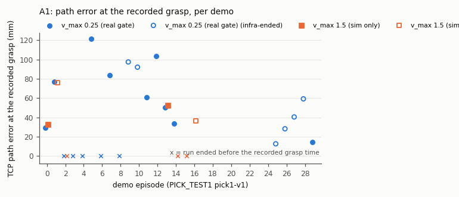
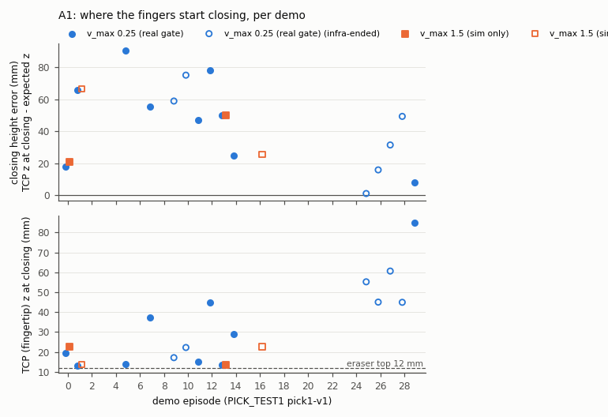

# 02_camera_study / A_baseline: the start pose as it is (A1 demo replays, A2 policies without correction)

**Status:** A1 partial, paused; A2 not run · **Date:** 2026-11-20 (A1 ran 10:37-10:56; closed 2026-11-20) ·
**Who:** agent A (skeleton: lead agent; results written from the raw files when the study was closed) ·
**Plan ref:** sim_deploy/PLAN.md §10 (A1, A2), §11 ("Progress so far", camera-study row), §9 (start pose), §6 "P3" table
(G6, G7); DESIGN.md "E7", "P1", "P2", "P3/P4"

> **At the pause (2026-11-20 ~10:56):** A1 had 30 of its 60 planned replay evals on disk: 23 at v_max 0.25 (demos 0-17
> and 25-29) and 7 at v_max 1.5 (demos 0, 1, 2, 13, 14, 15, 16). 3 + 2 of them grasp, lift and succeed. 11 of the 30
> were ended by the host, not by the physics. Every box (floor) fault is a demo whose recorded path, carried to the
> start pose, ends 7-13 cm below the table. **A2 was not run** (no `campA2` eval folder or `index.csv` row). The study
> folded into PLAN §11 W2 ([../../03_policy_pipeline/W2_sim_look/README.md](../../03_policy_pipeline/W2_sim_look/README.md)).
> Closed-loop policy evals from the start pose (what A2 was) are W3's first step. Sections below "Commands" give the results.

## Question

From the recommended start pose `leftx55_t48_h16`, with the sim unchanged:

- **A1 (pose and physics):** how many of the 30 PICK_TEST1 demos, replayed open loop with the eraser where that demo
  grasped, grasp and lift it, at the real `v_max` 0.25 m/s and at a sim-only 1.5 m/s? With what path error and which
  faults?
- **A2 (policies as they are):** how many of the 14 runnable checkpoints succeed, grasp, approach (closest TCP to the
  eraser < 5 cm) or fault in 3 episodes each, and does their first chunk point toward the eraser or away?

PLAN §10 reads the two together: if the motions run (A1) and the policies do not (A2), the start pose and the physics
are not the problem and the camera view is (phases B, C).

## Why it matters for the real robot

- `leftx55_t48_h16` is also the start pose recommended for the real arm (DESIGN.md "P3/P4"). If the demos' motions
  carry from it (at 1.5, where the gate does not shorten them), the pose, the grasp physics and the conventions are
  not why the policies fail. If they do not, the pose itself is a problem (a real-world one).
- The 0.25 pass uses the real PC's gate value: it shows what the real gate does to open-loop demo-speed motions (P3's
  G6: segments faster than the gate are shortened and never made up). The 1.5 m/s pass is sim-only; the real PC keeps
  0.25.
- A2 is the baseline that C2 (policies with the camera fixes) is compared with, at the same seeds. If the policies
  already approach from this pose, P3's retreat (from the older stand-in) was a start-pose effect, not a camera one.
  A alone does not tell geometry (the mount's view: a real-robot problem) from appearance (a sim-only problem); C1
  does.

## Setup

| Item | Value |
|---|---|
| Repo / branch | `~/Capstone-main-sim`, `rnoro/main-sim` @ `3633fcb` (+ uncommitted `sim_deploy/`, `deployment/`); each `eval.yaml` `git.sim_deploy` = `3633fcb3b23a…-dirty` |
| Model | `sim_deploy/build/sim_rig/model.json` `model_sha256` `166a0649571a…` (table top O z 0, x -0.40..1.00, y ±0.80, base on the table; E7 appearance = the "current" look: procedural light-wood table, directional lights, kit colours, ArUco tag textures; E7 fin-ray contact pairs); built 09:40 |
| Baseline (unchanged) | no change to the look, geometry, cameras, the `deployment/` copy or `start_pose.yaml` in this phase. File times: newest in `deployment/` 09:13, `sim_rig.yaml` / `control_sim.yaml` / `model.json` 09:40, `start_pose.yaml` 10:18, `vmax15_campA.yaml` 10:36; first A1 eval 10:37 |
| Home / start pose | `--home start` (default; `eval.yaml home.variant: start`): PC `h`, PC `p` to `stations/start_pose.yaml` = `leftx55_t48_h16`, `q_start_rad [-0.5928536, 0.5219462, -0.0897168, -1.5930073, 0.6595725, 1.5068439, -1.5301472]`: TCP O (0.531, -0.159, 0.160), 16.0 cm above the table, tilt 48.0 deg, fingertips pointing to the robot's left (demos' median start 48.2 deg / 16.3 cm: `eval.yaml vs_demos`); then the eraser, then the laptop's `c` |
| Eraser placement | A1: replay placement of episode `i` (`scene/placement.py replay_placement`: the eraser where that demo's grasp happens, carried from the start TCP, `O_T_grasp = O_T_TCP_start . inv(P_s) . P_g`). A2: `scene/randomization_start.yaml` (`pick_eraser_start_v1`, seeded): ahead 0.090-0.217 m, left -0.035..-0.003 m, yaw_rel -6.6..+0.8 deg (the demos' 10th-90th percentiles; median 15.9 cm ahead, 1.9 cm right, -2.2 deg) |
| Stations / overlays | `stations/control_sim.yaml` + `start_pose.yaml`, merged by `run.sh` into `build/control_sim_start.merged.yaml`. Real limits: v_max 0.25 m/s (copy's `config.yaml`; `control_sim.yaml` does not set it), w_max 1.0 rad/s, cone 60 deg, sim box [0.20, -0.40, -0.005]..[0.80, 0.40, 0.70]. Tag `campA1_v15` only: + `stations/vmax15_campA.yaml` via `SIM_DEPLOY_SIM_PC_OVERLAY` (`franka_control.safety.v_max_m_per_s: 1.5`, nothing else) |
| Policy / checkpoint | A1: `replay:~/data/umi/datasets/PICK_TEST1/pick1-v1/pick1-v1.zarr.zip#<i>`, i = 0..29 (30 episodes, 60 Hz low-dim). A2: the 14 runnable checkpoints of `python -m sim_deploy.ui.catalog --json` (table below), `~/Capstone/data/<task>/policy/<run>` |
| Inference settings | A1: none (replay). A2, every checkpoint: `--precision bf16 --diffusion-steps 8 --exec-h 12`. Training configs: `diffusers.DDIMScheduler`, `num_inference_steps` 16; behavior prompting trained in bf16, plain diffusion without mixed precision (run README "Precision: no") |
| Seeds / episodes | A1: `--seed 0`, 1 episode per replay (the replay placement does not use the seed). A2: `--seed 0`, 3 episodes; episode n = 0..2 uses `default_rng([0, n])`: the same eraser poses for every checkpoint (C2 reuses them) |
| Timeout | A1 `--timeout 25`; A2 `--timeout 60` |
| Other flags | A2 `--tap` (policy inputs/outputs in the session, incl. the first chunk `tap/chunk_1.npz`); normal homing speed (no `--fast-homing`) |
| Sim-only settings | v_max 1.5 m/s (`campA1_v15` only); sim box min x 0.20 / z -0.005 (upstream x 0.25 / z 0.05); stand-in `q_start_rad`; fin-ray contact pairs + finger servo kp 20000; width offset 0.0; E7 appearance ([sim-experiments/README.md](../../README.md), "Sim-only settings") |
| How it ran | A1: up to 3 chains in parallel, each in its own user + network namespace (`unshare -rn`, `ip link set lo up`: own loopback, same ports), `run.sh` starts spaced by a `flock` (1.5 s). A2: one chain at a time on the host network (GPU 4 GB); loadavg, `nvidia-smi` memory / utilisation and the top 3 processes logged every 5 s per checkpoint |
| Real-time check | the sim PC's `sim: run totals: ... (rtf X)` line in `sim_evals/_logs/<date_time>/sim_pc.log`: rtf >= 0.99 per run |

A2 checkpoints (kind and dataset from the catalog and each run's README.md; every run trained 60 of 60 epochs;
checkpoint epoch and val MSE: [study overview](../README.md), "Runnable checkpoints"):

| Checkpoint | Kind (train config) | Training dataset | Episodes |
|---|---|---|---|
| PICK_DOUBLE/run_002_2026-11-19 | plain (`umi_policy_dunet`) | pick1-double-v2 | 62 (30 + 32, two days) |
| PICK_DOUBLE/run_003_2026-11-19 | plain | pick1-double-ep15-v1 | 30 (15 + 15) |
| PICK_DOUBLE/run_004_2026-11-19 | plain | pick1-double-ep20-v1 | 40 (20 + 20) |
| PICK_DOUBLE/run_005_2026-11-19 | plain | pick1-double-ep25-v1 | 50 (25 + 25) |
| PICK_TEST1/run_006_2026-11-18 | behavior prompting (`umi_policy_dunetp`) | pick1-v1 | 30 |
| PICK_TEST1/run_012_2026-11-18 | behavior prompting | pick1-ep15-v1 | 15 |
| PICK_TEST1/run_014_2026-11-18 | behavior prompting | pick1-ep20-v1 | 20 |
| PICK_TEST1/run_016_2026-11-18 | behavior prompting | pick1-ep25-v1 | 25 |
| PICK_TEST1/run_020_2026-11-19 | behavior prompting | pick1-ep10-v1 | 10 |
| PICK_TEST1/run_022_2026-11-19 | plain | pick1-v1 | 30 |
| PICK_TEST1/run_024_2026-11-19 | plain | pick1-ep25-v1 | 25 |
| PICK_TEST1/run_028_2026-11-19 | plain | pick1-ep15-v1 | 15 |
| PICK_TEST1/run_030_2026-11-19 | plain | pick1-ep10-v1 | 10 |
| PICK_TEST1/run_031_2026-11-19 | plain | pick1-ep20-v1 | 20 |

## Method

Order: A1 (`campA1_v025` and `campA1_v15`), then A2 (`campA2`). Every episode is judged by the eval driver
(`sim_deploy/eval/driver.py`, 20 Hz sim ground truth; success / grasp / lift as in
[sim-experiments/README.md](../../README.md)).

| Step | Tool | What it shows |
|---|---|---|
| A1 v025 | `run.sh --policy "replay:<zarr>#<i>"`, i = 0..29, real gate | whether the demo motions, carried to the start pose, grasp and lift under the real gate |
| A1 v15 | the same + `vmax15_campA.yaml` | the same with the speed limit out of the way: pose, IK, geometry and grasp physics alone |
| A1 rows | `sim_evals/_camera_study/A/tools/a1_rows.py OUT_CSV` | one row per replay eval (below) |
| A2 | `run.sh --policy <RUN_FOLDER>` x 14, 3 episodes each, `--tap` | baseline success / grasp / approach / faults from the start pose, and the first chunk's direction |
| A2 rows | `sim_evals/_camera_study/A/tools/a2_rows.py TAG OUT_EP_CSV OUT_CKPT_CSV` | one row per episode and one per checkpoint (below) |
| rtf | `grep 'run totals' sim_evals/_logs/<date_time>/sim_pc.log` | the sim ran in real time |

**`a1_rows.py`** (per eval folder `pick1-v1_ep*/*_campA1_{v025,v15}`, skipping `SUPERSEDED.txt`; reads `eval.yaml`,
`episodes.jsonl`, `episodes/000/trace.json` and the zarr episode):

- outcome, grasped, lifted, success, max lift (cm), time to grasp, duration, table-contact geoms;
- recorded grasp time = `grasp_rows(widths)["start"] / 60` s (the last row before the width falls below open - 15 % of
  the open-to-hold drop);
- path error (P3's `g6_path.py` method): the replayed TCP (trace, 20 Hz) vs the recording carried to the episode's
  start TCP, `O_T(t) = O_T_start . inv(P_0) . P_(60 t)`, at the time lag in -0.3..1.0 s (0.02 s steps) that minimises
  the median; reports the median (mm), the error at the recorded grasp start (mm, and its x / y / z) and the lag;
- closing: the first trace row with finger gap < 0.07 m (fingers start at 0.080): its time, its height error (TCP z
  minus the expected TCP z at the recorded grasp start, mm) and its distance to that point (mm);
- the gate's C2 counters (`shortened`, `pulled_back`, `rejected`), the fault text and its rule (`box_<axis>`, `cone`,
  `max_lead`, `reflex`, `watchdog`, `joint`, `velocity`, `other`).

**`a2_rows.py`** (per eval folder `PICK_*/run_*/*_<TAG>`, skipping `SUPERSEDED.txt`, `not_run` and `interrupted`):

- per episode: outcome, grasped, lifted, success, max lift, duration, fault rule and time;
- approach: TCP (fingertip point, trace) to the eraser centre (`eraser_settled_pose`): at the start (`d_start_cm`),
  its minimum (`d_min_cm`) and when; the highest TCP z (cm);
- first chunk (`tap/chunk_1.npz`, relative to the anchor = the start TCP): the chunk's last step (16 steps) projected
  on the unit vector start TCP -> eraser (`chunk1_toward_eraser_cm`, + = toward), the same for the 12th executed
  waypoint (`wp12_toward_eraser_cm`), the chunk end along the TCP z axis (`chunk1_along_tcp_z_cm`, + = toward the
  fingertips: P3's offline measure, +5.6 cm for run_006 on training images, -1.3 cm on the sim's), its length and its
  O z change;
- inference: `policy_ms_p50`, `policy_ms_p95`, `margin_ms_min`, sent / skipped steps and reasons; gate `shortened`,
  `pulled_back`;
- per checkpoint: kind, dataset, success / grasped / lifted counts, outcomes, faults by rule, the per-episode values
  above joined with `/`, metrics.json's inference numbers, restarts, eval folder.

**What counts as a pass (set before the results):**

| Readout | Pass |
|---|---|
| A1, per replay | judge `success` (eraser >= 5 cm above its start for 1 s). Compared with P3's G6 from the stand-in (replays 19 / 0: success, 14.5 / 26.6 mm at the recorded grasp). At v15 a non-success without gate shortening points at the pose, IK or grasp physics; at v025 a non-success with shortened waypoints is G6's open-loop speed effect |
| A2, per checkpoint | runs = at least 1 of 3 episodes grasps; approaches = `d_min_cm` < 5 without a grasp (the sweep screen's "approach"); first chunk toward the eraser = `chunk1_toward_eraser_cm` > 0 |
| A2 inference | within the `exec_h` budget: `margin_ms_min` >= 0 and 0 skipped steps (G7) |
| every run | sim PC rtf >= 0.99 |

## Commands to reproduce

Nothing else may hold the sim ports (`ss -ltn | grep -E ':(5555|56[0-9]{2}) '` prints nothing), except for A1 chains
in their own network namespace (`a1ns.sh`). A2 needs the GPU (4 GB) alone and runs after A1. Run time: A1 44-53 s
per replay eval with one chain (eps 1-5), 52-91 s with chains in parallel or a 25 s timeout (driver-log timestamps;
the skeleton's "~45-65 s" was an estimate), 60 evals planned; A2 per checkpoint: policy start, `h`, `p` (14.5 s) and
3 episodes of up to 60 s, 14 checkpoints in a row.

The four scripts and the run list below are copied verbatim from the session scratch folder
`/tmp/claude-1000/-home-ruben-Capstone/20deb2cf-0c82-44ce-870d-39667f0b1130/scratchpad/campA/` (`$S` in them; not
durable). To rerun, save them in a folder and change each `S=` line to it (the logs go there).

`a1.sh` (one chain; `PASSES` and `EPS` pick passes and episodes):

```bash
#!/usr/bin/env bash
# camera study A1: 30 PICK_TEST1 replays from the start pose, v_max 0.25 then sim-only 1.5
cd ~/Capstone-main-sim && unset PYTHONPATH
Z=/home/ruben/data/umi/datasets/PICK_TEST1/pick1-v1/pick1-v1.zarr.zip
S=/tmp/claude-1000/-home-ruben-Capstone/20deb2cf-0c82-44ce-870d-39667f0b1130/scratchpad/campA
export SIM_DEPLOY_START_TRIES=12 SIM_DEPLOY_START_WAIT_S=10
for pass in ${PASSES:-v025 v15}; do
  for i in ${EPS:-$(seq 0 29)}; do
    if [[ $pass == v15 ]]; then export SIM_DEPLOY_SIM_PC_OVERLAY=$HOME/Capstone-main-sim/sim_deploy/stations/vmax15_campA.yaml; else unset SIM_DEPLOY_SIM_PC_OVERLAY; fi
    echo "=== $(date +%T) A1 $pass ep $i load: $(cut -d' ' -f1-3 /proc/loadavg)"
    sim_deploy/run.sh --policy "replay:$Z#$i" --episodes 1 --seed 0 --tag campA1_$pass --timeout 25 > "$S/a1_${pass}_$i.log" 2>&1
    echo "    exit $? $(grep -m1 '\[eval\] eval folder' "$S/a1_${pass}_$i.log")"
  done
done
echo "=== done $(date +%T)"
```

`a1b.sh` (the same with the start `flock`, for chains in parallel):

```bash
#!/usr/bin/env bash
# camera study A1: 30 PICK_TEST1 replays from the start pose, v_max 0.25 then sim-only 1.5
cd ~/Capstone-main-sim && unset PYTHONPATH
Z=/home/ruben/data/umi/datasets/PICK_TEST1/pick1-v1/pick1-v1.zarr.zip
S=/tmp/claude-1000/-home-ruben-Capstone/20deb2cf-0c82-44ce-870d-39667f0b1130/scratchpad/campA
export SIM_DEPLOY_START_TRIES=12 SIM_DEPLOY_START_WAIT_S=10
for pass in ${PASSES:-v025 v15}; do
  for i in ${EPS:-$(seq 0 29)}; do
    if [[ $pass == v15 ]]; then export SIM_DEPLOY_SIM_PC_OVERLAY=$HOME/Capstone-main-sim/sim_deploy/stations/vmax15_campA.yaml; else unset SIM_DEPLOY_SIM_PC_OVERLAY; fi
    echo "=== $(date +%T) A1 $pass ep $i load: $(cut -d' ' -f1-3 /proc/loadavg)"
    flock "$S/start.lock" sleep 1.5   # chains in parallel: no two run.sh starts in the same second (_logs/<date_time>)
    sim_deploy/run.sh --policy "replay:$Z#$i" --episodes 1 --seed 0 --tag campA1_$pass --timeout 25 > "$S/a1_${pass}_$i.log" 2>&1
    echo "    exit $? $(grep -m1 '\[eval\] eval folder' "$S/a1_${pass}_$i.log")"
  done
done
echo "=== done $(date +%T)"
```

`a1ns.sh` (one `a1b.sh` chain in its own user + network namespace):

```bash
#!/usr/bin/env bash
# one A1 chain in its own user + network namespace (own loopback: ports 5555..5651 do not collide with other chains)
# usage: a1ns.sh CHAIN_NAME PASS "EPISODES..."   (driver log: $S/a1_driver_<CHAIN_NAME>.log)
S=/tmp/claude-1000/-home-ruben-Capstone/20deb2cf-0c82-44ce-870d-39667f0b1130/scratchpad/campA
name=$1 pass=$2 eps=$3
exec unshare -rn bash -c "ip link set lo up && PASSES='$pass' EPS='$eps' '$S/a1b.sh'" > "$S/a1_driver_$name.log" 2>&1
```

`a2.sh` (A2, one checkpoint after the other, host network):

```bash
#!/usr/bin/env bash
# camera study A2: every runnable checkpoint x 3 episodes (seed 0: episodes 0..2), start pose, real limits
cd ~/Capstone-main-sim && unset PYTHONPATH
S=/tmp/claude-1000/-home-ruben-Capstone/20deb2cf-0c82-44ce-870d-39667f0b1130/scratchpad/campA
export SIM_DEPLOY_START_TRIES=12 SIM_DEPLOY_START_WAIT_S=10
unset SIM_DEPLOY_SIM_PC_OVERLAY
TAG=${TAG:-campA2}
for run in ${RUNS}; do
  name=$(echo $run | tr / _)
  echo "=== $(date +%T) A2 $run load: $(cut -d' ' -f1-3 /proc/loadavg) gpu: $(nvidia-smi --query-gpu=memory.used,utilization.gpu --format=csv,noheader)"
  ( while true; do echo "$(date +%T) $(cut -d' ' -f1-3 /proc/loadavg) $(nvidia-smi --query-gpu=memory.used,utilization.gpu --format=csv,noheader) top: $(ps -eo pcpu,comm --sort=-pcpu --no-headers | head -3 | tr -s ' ' | tr '\n' ';')"; sleep 5; done ) > "$S/a2_load_${TAG}_$name.log" 2>&1 &
  lp=$!
  sim_deploy/run.sh --policy "/home/ruben/Capstone/data/$run" --episodes 3 --seed 0 --tag $TAG --timeout 60 \
    --precision bf16 --diffusion-steps 8 --exec-h 12 --tap > "$S/a2_${TAG}_$name.log" 2>&1
  code=$?
  kill $lp 2>/dev/null
  echo "    exit $code $(grep -m1 '\[eval\] eval folder' "$S/a2_${TAG}_$name.log")"
done
echo "=== done $(date +%T)"
```

`a2_runs.txt` (one line):

```
PICK_DOUBLE/policy/run_002_2026-11-19 PICK_DOUBLE/policy/run_003_2026-11-19 PICK_DOUBLE/policy/run_004_2026-11-19 PICK_DOUBLE/policy/run_005_2026-11-19 PICK_TEST1/policy/run_006_2026-11-18 PICK_TEST1/policy/run_012_2026-11-18 PICK_TEST1/policy/run_014_2026-11-18 PICK_TEST1/policy/run_016_2026-11-18 PICK_TEST1/policy/run_020_2026-11-19 PICK_TEST1/policy/run_022_2026-11-19 PICK_TEST1/policy/run_024_2026-11-19 PICK_TEST1/policy/run_028_2026-11-19 PICK_TEST1/policy/run_030_2026-11-19 PICK_TEST1/policy/run_031_2026-11-19
```

Run:

```bash
cd ~/Capstone-main-sim && unset PYTHONPATH
S=<folder with the scripts>

# the checkpoints (14 runnable expected)
~/envs/sim_deploy/bin/python -m sim_deploy.ui.catalog --json --no-replays

# A1 as one chain (both passes, 60 evals) ...
"$S/a1.sh" > "$S/a1_driver.log" 2>&1
# ... or as up to 3 chains in parallel, each in its own namespace (any split of passes / episodes; the split
# actually used is in $S/a1_driver_<chain>.log):
"$S/a1ns.sh" chain1 v025 "$(seq -s' ' 0 14)" &
"$S/a1ns.sh" chain2 v025 "$(seq -s' ' 15 29)" &
"$S/a1ns.sh" chain3 v15  "$(seq -s' ' 0 29)" &
wait

# A2 (after A1; alone on the GPU and the ports)
RUNS="$(cat "$S/a2_runs.txt")" "$S/a2.sh" > "$S/a2_driver.log" 2>&1

# rows (planned; at the pause only the interim a1_episodes.csv / a1_summary.md existed, see Raw data)
~/envs/sim_deploy/bin/python sim_evals/_camera_study/A/tools/a1_rows.py sim_evals/_camera_study/A/<A1_OUT>.csv
~/envs/sim_deploy/bin/python sim_evals/_camera_study/A/tools/a2_rows.py campA2 sim_evals/_camera_study/A/<A2_EP>.csv sim_evals/_camera_study/A/<A2_CKPT>.csv

# real-time check, and which log folder belongs to an eval folder
grep -H 'run totals' sim_evals/_logs/2026-11-20_*/sim_pc.log
grep -l '<EVAL>' sim_evals/_logs/*/eval.log
```

**What actually ran** (from the driver logs, copied to [data/campA_logs/](data/campA_logs/); the 1-min loadavg is
what each driver line printed at the start of an eval):

| Time (EST) | Chains | What ran | loadavg |
|---|---|---|---|
| 10:37:06-10:42:48 | 1, host network (`a1.sh`) | v025 eps 0-6 | 4.0-12.3 |
| 10:43:13-10:47:42 | 3, each in its own namespace (`a1ns.sh`: `chain1`, `chain2a`, `chain3`) | chain1 v025 eps 7, 8, 9, 10; chain2a v025 eps 25, 26, 27, 28; chain3 v15 eps 13, 14, 15, 16 | 8.4-56.2 |
| 10:47:42-10:49:22 | 2 (+ v15 ep 17 started twice by chain3 / `chain3_cont`, terminated both times before an eval folder existed: `_logs/2026-11-20_104744`, `_104823`) | chain1 v025 eps 10, 11; chain2a v025 ep 29 | 38.8-51.4 |
| 10:49:22-10:52:18 | 2 (`chain1`, `chain2b`) | chain1 v025 eps 12, 13; chain2b v15 eps 0, 1, 2 (its driver was stopped after ep 2) | 38.8-42.4 |
| 10:52:20-10:56:38 | 1 (`chain1`), B's CPU tools writing at the same time (`B/reference/` 10:54:15-10:54:57, `B/corr_main/` 10:55:51-52) | v025 eps 14, 15, 16, 17; ep 17's sim restart was terminated (`run.sh` exit 130) when the study paused | 16.0-36.1 |

The split is not the 0-14 / 15-29 / v15 example above. v025 and v15 chains ran at the same time, although
`a1ns2.sh`'s comment says "Run only chains of ONE pass at a time" (all chains rewrite
`build/control_sim_start.merged.yaml`). The v_max each run actually loaded was checked: franka_control's
`config_effective.yaml` matches the tag in all 27 interim runs (interim summary, "Checks") and in v025 eps 15, 16, 17
(0.25, read while closing).

## Results

All numbers below are re-derived here from the raw eval folders (`episodes.jsonl`, `eval.yaml`,
`episodes/000/trace.json`, the zarr episode). The tool is [data/rederive_a1.py](data/rederive_a1.py): own read-only
code with the same method as `tools/a1_rows.py`, output [data/a1_rows_rederived.csv](data/a1_rows_rederived.csv).
For the 27 evals in the interim `a1_episodes.csv` (10:54) it reproduces outcome, gate `shortened`, path error, error
at the recorded grasp, expected grasp z and closing z / dz within 0.15 mm. The three evals that finished after 10:54
(v025 eps 15, 16, 17) are only in the re-derived file.

### A1: counts per tag (raw `episodes.jsonl`, one episode per eval folder)

| Tag | Eval folders (demos) | Ran (not `not_run`) | Success = grasp = lift | Box (floor) faults | Timeouts | Ended by the host (infra) | Physical runs (not infra) | Success of physical runs |
|---|---|---|---|---|---|---|---|---|
| `campA1_v025` (real v_max 0.25) | 23 (0-17, 25-29) | 22 | **3** (0, 1, 13) | 7 (2, 3, 4, 5, 6, 8, 15) | 5 (7, 11, 12, 14, 29) | 8: health aborts 9, 10, 16, 25, 26, 28; realtime faults 27 (in the episode) and 17 (at start-up, `not_run`) | 15 | **3 / 15** |
| `campA1_v15` (sim-only v_max 1.5) | 7 (0, 1, 2, 13, 14, 15, 16) | 7 | **2** (0, 13) | 2 (2, 15) | 0 | 3: health aborts 1, 14, 16 | 4 | **2 / 4** |

- Outcomes: v025 fault 8 (7 box + ep 27's realtime fault), stopped 6, timeout 5, success 3, not_run 1; v15 stopped 3,
  success 2, fault 2. Every grasp lifted and succeeded (max lift 12.4-20.1 cm). No cone, reflex, joint or velocity
  fault occurred, and no box fault in x or y. The start pose was reached in all 29 runs that started (`p` 14.48-14.54 s,
  max joint error 0.00012 rad, tilt 48.00-48.01 deg, 15.99 cm).
- `sim_evals/index.csv` has one row for each of the 30 folders (rows 44-73, none missing). Its sums are the same:
  v025 3 successes, 8 faults, 6 stops, 5 timeouts; v15 2 / 2 / 3 / 0. Each `metrics.json` agrees: success k, faults.
- **Beside PLAN §11** ("3/24 grasp at v 0.25"): raw = **3 of 23** v025 evals, 3 of the 22 that ran, 3 of the 15 not
  ended by the host. No 24th v025 eval exists on disk. PLAN §11 gives no v1.5 number; raw = 2 of 7 (2 of 4 physical).
- Nothing was still running, and nothing lacks `metrics.json` or an index row. The only incomplete record is v025
  ep 17 (`not_run`, no trace). The two v15 ep 17 attempts left only `_logs/2026-11-20_104744/` and `_104823/` (a
  `sim_pc.log` each), no eval folder.

### A1: per run

Columns: demo start height = the recorded fingertip height at the demo's first row (`eval.yaml`
`replay_placement.recorded_start_tip_height_m`). Carried grasp z = where the recorded grasp lands when the demo is
carried to the sim start TCP, `O_T_TCP_start . inv(P_0) . P_grasp` (`grasp_tip_above_table_m`; negative = below the
table top). End = `duration_s` and why. Path error = median TCP distance to the carried recording at the fitted lag,
over the part that ran. Closing = the first trace row with finger gap < 0.0795 m. Closing dz = its TCP z minus the
expected z at the recorded grasp, taken from the trace's first row; that expected z differs from the carried grasp z
column by <= 0.5 mm. "-" = not reached.

`campA1_v025`:

| Ep | Demo start height (cm) | Carried grasp z (mm) | Outcome | G / L / S | End (s): reason | Shortened | Path err median (mm) | Lag (s) | Err at rec. grasp (mm) | Closing TCP z (mm) | Closing dz (mm) |
|---|---|---|---|---|---|---|---|---|---|---|---|
| 0 | 16.6 | 2.1 | success | 1/1/1 | 4.97: success | 40 | 18.5 | -0.12 | 29.1 | 19.5 | 17.8 |
| 1 | 16.2 | -52.6 | success | 1/1/1 | 3.77: success | 79 | 50.8 | +0.22 | 76.8 | 13.1 | 66.1 |
| 2 | 21.6 | -70.8 | fault | 0/0/0 | 1.15: box z (waypoint at z -0.017 m) | 67 | 3.9 | -0.02 | - | - | - |
| 3 | 25.2 | -106.1 | fault | 0/0/0 | 1.10: box z (waypoint at z -0.027 m) | 62 | 3.8 | -0.02 | - | - | - |
| 4 | 27.1 | -127.2 | fault | 0/0/0 | 1.16: box z (waypoint at z -0.015 m) | 62 | 1.5 | +0.00 | - | - | - |
| 5 | 23.8 | -76.7 | fault | 0/0/0 | 6.43: box z (waypoint at z -0.015 m) | 123 | 92.6 | +0.24 | 121.8 | 13.8 | 90.7 |
| 6 | 25.6 | -118.3 | fault | 0/0/0 | 1.06: box z (waypoint at z -0.016 m) | 71 | 3.8 | -0.02 | - | - | - |
| 7 | 19.2 | -18.0 | timeout | 0/0/0 | 25.05: timeout 25 s | 162 | 86.8 | -0.30 | 83.9 | 37.1 | 55.3 |
| 8 | 23.6 | -74.4 | fault | 0/0/0 | 1.10: box z (waypoint at z -0.019 m) | 75 | 3.0 | +0.00 | - | - | - |
| 9 | 21.2 | -41.6 | stopped | 0/0/0 | 10.13: frames health abort (infra) | 149 | 75.8 | -0.22 | 97.5 | 17.1 | 59.0 |
| 10 | 21.9 | -52.7 | stopped | 0/0/0 | 21.34: frames health abort (infra) | 136 | 80.0 | +0.26 | 92.1 | 22.2 | 75.2 |
| 11 | 19.8 | -31.7 | timeout | 0/0/0 | 25.00: timeout 25 s | 151 | 60.6 | -0.04 | 61.0 | 15.0 | 47.0 |
| 12 | 19.9 | -33.2 | timeout | 0/0/0 | 25.02: timeout 25 s | 201 | 105.2 | -0.28 | 103.5 | 44.9 | 78.4 |
| 13 | 19.0 | -36.3 | success | 1/1/1 | 3.82: success | 47 | 22.3 | -0.12 | 50.3 | 13.4 | 50.1 |
| 14 | 16.3 | 4.5 | timeout | 0/0/0 | 25.04: timeout 25 s | 68 | 60.2 | +0.10 | 33.7 | 28.9 | 24.8 |
| 15 | 24.0 | -82.0 | fault | 0/0/0 | 1.96: box z (waypoint at z -0.015 m) | 39 | 5.0 | -0.04 | - | - | - |
| 16 | 16.3 | -2.6 | stopped | 0/0/0 | 17.26: frames health abort (infra) | 131 | 78.6 | -0.22 | 91.5 | 48.8 | 51.7 |
| 17 | 14.4 | 29.5 | not_run | 0/0/0 | -: realtime fault (50.1 ms) at policy_deploy start-up (infra) | - | - | - | - | - | - |
| 25 | 6.2 | 54.5 | stopped | 0/0/0 | 3.01: frames health abort (infra) | 12 | 9.9 | -0.06 | 12.5 | 55.2 | 1.1 |
| 26 | 8.8 | 29.4 | stopped | 0/0/0 | 4.47: frames health abort (infra) | 34 | 27.1 | +0.12 | 28.1 | 45.0 | 15.9 |
| 27 | 9.5 | 29.4 | fault | 0/0/0 | 7.36: realtime: physics 53.1 ms behind wall time (infra) | 67 | 51.2 | +0.02 | 40.4 | 60.6 | 31.5 |
| 28 | 10.2 | -4.2 | stopped | 0/0/0 | 1.89: frames health abort (infra) | 25 | 6.4 | -0.04 | 59.2 | 44.9 | 49.4 |
| 29 | 7.7 | 77.2 | timeout | 0/0/0 | 25.04: timeout 25 s | 99 | 36.4 | +0.00 | 14.3 | 85.0 | 8.1 |

`campA1_v15`:

| Ep | Demo start height (cm) | Carried grasp z (mm) | Outcome | G / L / S | End (s): reason | Shortened | Path err median (mm) | Lag (s) | Err at rec. grasp (mm) | Closing TCP z (mm) | Closing dz (mm) |
|---|---|---|---|---|---|---|---|---|---|---|---|
| 0 | 16.6 | 2.1 | success | 1/1/1 | 4.97: success | 29 | 18.6 | -0.16 | 32.4 | 22.7 | 20.9 |
| 1 | 16.2 | -52.6 | stopped | 0/0/0 | 2.61: frames health abort (infra) | 12 | 15.6 | +0.00 | 76.2 | 13.8 | 66.7 |
| 2 | 21.6 | -70.8 | fault | 0/0/0 | 1.17: box z (waypoint at z -0.018 m) | 2 | 4.0 | -0.08 | - | - | - |
| 13 | 19.0 | -36.3 | success | 1/1/1 | 3.91: success | 16 | 32.3 | -0.18 | 51.9 | 13.3 | 49.9 |
| 14 | 16.3 | 4.5 | stopped | 0/0/0 | 0.96: frames health abort (infra) | 0 | 1.9 | -0.02 | - | - | - |
| 15 | 24.0 | -82.0 | fault | 0/0/0 | 1.98: box z (waypoint at z -0.019 m) | 3 | 3.4 | +0.00 | - | - | - |
| 16 | 16.3 | -2.6 | stopped | 0/0/0 | 3.96: frames health abort (infra) | 4 | 37.0 | +0.06 | 36.2 | 22.6 | 25.5 |

The box-fault texts are all of the form "safety gate rejected waypoint 6 or 7 of chunk N: outside workspace box by
0.010-0.022 m on z (z = ... < min -0.005 m, margin 0.010 m)" (`episodes.jsonl` `fault`): a waypoint 0.30-0.35 s
ahead. In the 8 approach faults (1.06-1.98 s) the TCP itself was still 21.5-98.8 mm above the table when the gate
refused (the trace's lowest TCP z); v025 ep 5 faulted at 6.43 s after closing at 13.8 mm. The short traces of the
approach faults explain their small path errors (1.5-5.0 mm).

### A1: path error and closing (distribution over runs)

| Tag, runs | Path err median (mm) | Err at rec. grasp (mm) | Closing TCP z (mm) | Closing dz (mm) |
|---|---|---|---|---|
| v025, all that ran (22; 16 reach the grasp / close) | median 31.8 (1.5-105.2) | median 60.1 (12.5-121.8) | median 33.0 (13.1-85.0) | median 49.7 (1.1-90.7) |
| v025, physical only (15; 9 reach the grasp / close) | median 22.3 (1.5-105.2) | median 61.0 (14.3-121.8) | median 19.5 (13.1-85.0) | median 50.1 (8.1-90.7) |
| v15, all (7; 4 reach the grasp / close) | median 15.6 (1.9-37.0) | median 44.1 (32.4-76.2) | median 18.2 (13.3-22.7) | median 37.7 (20.9-66.7) |
| v15, physical only (4; 2 reach the grasp / close) | median 11.3 (3.4-32.3) | 32.4, 51.9 | 13.3, 22.7 | 20.9, 49.9 |

Speeds (interim csv columns, spot-checked here: the replay peak speed over the whole run matches the trace in all 27
rows): the recorded peak 50 ms speed before the grasp is 0.48-1.53 m/s (v025 rows) and 0.48-1.25 m/s (v15 rows).
The replay's peak over the whole run is 0.20-0.36 m/s at v025 (0.23 / 0.26 for eps 15 / 16, after the interim) and
0.17-0.32 m/s at v15. In `sim_pc.log`, the gate's shortened lines carry 1652 v_max and 275 w_max clauses over the 20
interim v025 runs, and 4 v_max and 66 w_max clauses over the 7 v15 runs.

### A1: paired v025 / v15 (the 7 demos run at both speeds)

| Ep | v025 | v15 | Err at rec. grasp v025 / v15 (mm) | Closing TCP z v025 / v15 (mm) | Closing dz v025 / v15 (mm) | Shortened v025 / v15 |
|---|---|---|---|---|---|---|
| 0 | success | success | 29.1 / 32.4 | 19.5 / 22.7 | 17.8 / 20.9 | 40 / 29 |
| 1 | success | stopped (infra, 2.61 s) | 76.8 / 76.2 | 13.1 / 13.8 | 66.1 / 66.7 | 79 / 12 |
| 2 | fault box z, 1.15 s | fault box z, 1.17 s | - / - | - / - | - / - | 67 / 2 |
| 13 | success | success | 50.3 / 51.9 | 13.4 / 13.3 | 50.1 / 49.9 | 47 / 16 |
| 14 | timeout | stopped (infra, 0.96 s) | 33.7 / - | 28.9 / - | 24.8 / - | 68 / 0 |
| 15 | fault box z, 1.96 s | fault box z, 1.98 s | - / - | - / - | - / - | 39 / 3 |
| 16 | stopped (infra, 17.26 s) | stopped (infra, 3.96 s) | 91.5 / 36.2 | 48.8 / 22.6 | 51.7 / 25.5 | 131 / 4 |

In the 4 pairs where neither run was ended by the host (eps 0, 2, 13, 15) the outcome is the same at both speeds, and
the grasp error and closing height differ by at most 3.3 mm.

Figures (interim, 27 evals at 10:54, made by `tools/a1_figs.py` from the interim csv; v025 eps 15-17 are not in
them):





### A1: the infra-ended runs

| Run | When (EST) | Ended by | Concurrent sim chains (from `_logs` / driver timestamps) |
|---|---|---|---|
| v025 ep 25, 26, 9, 10, 28; v15 ep 14, 16 | 10:44:16-10:48:27 | policy_deploy health abort: "FATAL manager: frames: no reply to c1.get_health/v1 within 0.1 s" (the manager log: "no reply within 0.050 s (sent once, not resent)"); outcome `stopped`, session reason = that text | 3 (10:43:13-10:47:42) or 2 |
| v15 ep 1 | 10:51:24 | the same | 2 (`chain1`, `chain2b`) |
| v025 ep 16 | 10:55:33 | the same | 1 (`chain1`), B's tools writing |
| **v025 ep 27** | 10:46:38.129 (`_logs/2026-11-20_104528/sim_pc.log` line 97), 7.36 s into the episode, after closing at 60.6 mm | `libfranka: communication_constraints_violation (sim: physics 53.1 ms behind wall time)`: the sim PC's realtime fault, latched as on the robot | **3**: v025 ep 9 (`_logs/2026-11-20_104548`, 10:45:48-10:47:01: 1414 slow steps (the most of any run), max lag 47.99 ms) and v15 ep 16 (`_logs/2026-11-20_104634`, started 10:46:34). loadavg 55.34 at 10:46:32, 56.24 at 10:46:42 |
| **v025 ep 17** | 10:56:19 | the same fault, "physics 50.1 ms behind wall time", reported while policy_deploy started (`policy_deploy.log`, session `manager.log`): `not_run`. `run.sh` restarted the sim to resume, then was terminated (exit 130) at the pause | 1 (`chain1`); B's `corr_main` fit wrote its output at 10:55:51-52; loadavg 16.01 at 10:55:37 |

- The rtf check passes in every run: `run totals` rtf 0.9992-1.0003 in all 31 `sim_pc.log` of the A1 period that
  have one (30 evals + the first v15 ep 17 attempt). The lowest is ep 27 (0.9992, 1 resync, max lag 53.09 ms). An rtf
  over the whole run does not catch a 50 ms stall. The max lag does: <= 9.2 ms in v025 eps 0-6 (one chain),
  11.3-53.1 ms while chains ran in parallel (10:43-10:52), 7.4-16.4 ms for v025 eps 14-16 with one chain again.
- Ep 17's 50.1 ms fault is not in `_logs/2026-11-20_105539/sim_pc.log`. `run.sh` rewrote that file at the restart,
  whose totals show 13.02 s, 0 slow steps. The fault text is in the eval folder's `policy_deploy.log` and in
  [data/campA_logs/a1_v025_17.log](data/campA_logs/a1_v025_17.log).
- The health aborts cluster in the parallel period. Slow steps per run (interim summary, re-read from the logs):
  3-18 for v025 eps 0-6 with one chain, 145-1414 while chains ran in parallel, 26-103 for v025 eps 14-16 with one
  chain again. Infra-ended v025 runs (interim's 6) had a median of 638, the others 22.

### A2

Not run: no `campA2*` eval folder under `sim_evals/PICK_*/`, no `campA2` row in `sim_evals/index.csv`, no
`tools/a2_rows.py` output. Its plan (14 checkpoints x 3 episodes, `--seed 0`, `--tap`) and tool are kept above for W3.

## Analysis

### The floor faults are replay start-height artefacts

An open-loop replay carries each demo's motion relative to its own first pose onto the sim's start TCP
(`O_T(t) = O_T_start . inv(P_0) . P(t)`). The sim starts every demo at TCP z 15.95 cm, tilt 48.05 deg (`episodes.jsonl` `tcp_start`). A demo
that started higher above its grasp than that descends by its own recorded drop, which ends below the table.
[data/carried_grasp_z.py](data/carried_grasp_z.py) splits the carried grasp z
([data/a1_carried_grasp_z.csv](data/a1_carried_grasp_z.csv), all 30 demos) into two parts. The height part,
15.95 cm minus the demo's recorded drop from start to grasp, is what the grasp z would be if the demo had started
with the sim's orientation. The rotation part is the rest, which comes from the demo's start tilt / heading differing
from the start pose's.

| Demo (runs) | Demo start height (cm) | Recorded drop to the grasp (cm) | Height part (mm) | Rotation part (mm) | Carried grasp z (mm) | Demo start tilt (deg) | Outcome |
|---|---|---|---|---|---|---|---|
| 2 (v025, v15) | 21.6 | 21.9 | -59.5 | -11.6 | -71.1 | 51.2 | box z fault, both |
| 3 | 25.2 | 25.6 | -96.2 | -10.2 | -106.5 | 51.3 | box z fault |
| 4 | 27.1 | 27.7 | -117.4 | -10.1 | -127.5 | 50.7 | box z fault |
| 5 | 23.8 | 24.0 | -80.4 | +3.4 | -77.0 | 47.1 | box z fault (6.43 s) |
| 6 | 25.6 | 26.4 | -104.1 | -14.5 | -118.7 | 52.0 | box z fault |
| 8 | 23.6 | 22.8 | -68.8 | -5.9 | -74.8 | 49.9 | box z fault |
| 15 (v025, v15) | 24.0 | 24.3 | -83.3 | +0.8 | -82.4 | 48.4 | box z fault, both |
| 1 (v025, v15) | 16.2 | 16.3 | -3.5 | -49.6 | -53.0 | 62.2 | v025 success (closes on the eraser top, 13.1 mm) |
| 28 | 10.2 | 11.2 | +48.0 | -52.5 | -4.6 | 63.9 | infra stop |
| 0 (v025, v15) | 16.6 | 16.3 | -3.9 | +5.6 | +1.7 | 45.3 | success, both |
| 29 | 7.7 | 8.5 | +74.5 | +2.3 | +76.8 | 46.7 | timeout, closes 85.0 mm above the table |

(Computed with the sim start TCP from `episodes.jsonl` `tcp_start`; `eval.yaml`'s `grasp_tip_above_table_m` differs by
<= 0.5 mm.)

- **The threshold is clean.** All 9 runs whose carried grasp is -70.8 mm or lower fault on box z (v025 2, 3, 4, 5, 6,
  8, 15; v15 2, 15). None of the 20 runs with a carried grasp at -52.7 mm or higher faults on the box. The gate's box
  min is z -0.005 m with a 0.010 m margin, and it refuses the first waypoint that goes below, 6-7 waypoints ahead.
- **For the 9 floor faults, the start height is the cause.** These demos started 21.6-27.1 cm above the table,
  5.6-11.1 cm above the start pose's 16.0 cm. Their height part is -59.5 to -117.4 mm, against a rotation part of
  -14.5 to +3.4 mm. Their start tilts (47.1-52.0 deg) are close to the start pose's 48.05 deg.
- **Two demos at the right height carry low because of their start tilt:** eps 1 and 28 started at tilt 62.2 /
  63.9 deg. Their rotation part (-49.6 / -52.5 mm) dominates. Ep 1 still grasped, because the fingertips stop on the
  eraser top and close there (closing TCP z 13.1 mm). The eraser (12 mm tall) rests on the table below the carried grasp
  (`scene/placement.py`; `eval.yaml` `replay_placement.height_error_m` reports the gap between the carried grasp and
  the resting height).
- **Demos that started lower than 16 cm close in the air:** eps 25, 26, 27, 29 (starts 6.2-9.5 cm; carried grasp z
  +29.4 to +77.2 mm) close at TCP z 45.0-85.0 mm. Ep 29 (physical) times out. The others were ended by the host.
- **The pose itself caused no fault.** No cone, reflex, joint, velocity, x or y box fault occurred in any of the 29
  runs. `p` reached the pose every time. Of the 14 physical misses (v025 12, v15 2), 9 are floor faults and 5 are
  v025 timeouts (eps 7, 11, 12, 14, 29). The timeouts close without a grasp (error at the recorded grasp 14.3-103.5
  mm) with 68-201 shortened waypoints. That is G6's open-loop speed effect at v025, which cannot be told apart from placement here:
  none of them ran at v15.
- PLAN §11's "replays need their own start height" (Known issues) is the fix this points to. A replay would start
  from the demo's own start pose / height, or the carried path would be shifted so that the recorded grasp lands at
  the recorded grasp height. Not run.

### v_max 1.5 changed little

- At v15 the gate's v_max is no longer what limits the arm (4 v_max vs 66 w_max clauses; at v025 1652 vs 275). The
  replay still peaks at 0.17-0.32 m/s, against 0.48-1.25 m/s in the recordings. What limits it at 1.5 (w_max 1.0
  rad/s, or the impedance controller: stiffness 800 N/m, `max_position_error_m` 0.03 in `config_effective.yaml`,
  per the interim summary) was not tested.
- In the 4 physical pairs the outcome did not change, and the grasp error / closing height moved by <= 3.3 mm. The
  v15 path errors are smaller (median 15.6 vs 31.8 mm over all runs). They are not comparable run for run, because
  v15 covers 7 demos and v025 covers 22.

### Infrastructure

11 of 30 evals were ended by the host: 9 policy_deploy health aborts and 2 sim realtime faults. Ep 27's fault (53.1
ms) happened with 3 chains running and loadavg ~55. Ep 17's (50.1 ms) happened with one A1 chain. B's tools wrote their last output 27 s
earlier (10:55:52), and the 1-min loadavg was 16.0 at 10:55:37 against 4-12 for one chain alone at 10:38-10:42, so
other load was present. What it was is not recorded. The parallel namespaces kept the ports apart, not the CPU. PLAN §11 records the lesson ("parallel sim chains
overloaded the CPU once (realtime fault)"); there were two such faults. PLAN §11's order rule ("the sim chain runs
one at a time unless a coordinator proves real-time holds with more") covers it. The proof needs the max lag, not the rtf.

### Docs vs raw data

1. **PLAN §11 "3/24 grasp at v 0.25":** raw 3 of 23 v025 evals (22 ran, ep 17 `not_run`), 3 of 15 physical;
   `sim_evals/_replay/PICK_TEST1/*/*campA1_v025/episodes.jsonl`. No 24th v025 eval exists. PLAN gives no v1.5 count;
   raw 2 of 7 (`*campA1_v15`).
2. **"The one libfranka communication_constraints_violation":** there are **two**, v025 ep 27 (53.1 ms, in the
   episode) and v025 ep 17 (50.1 ms, at policy_deploy start-up, outcome `not_run`;
   `.../pick1-v1_ep017/2026-11-20_1056_campA1_v025/policy_deploy.log`). The interim summary (10:54) predates ep 17.
   `sim-experiments/01_start_pose/README.md` ("Realtime fault: one (v025 ep 27)") also has only one. Ep 17's fault
   is missing from `_logs/2026-11-20_105539/sim_pc.log` because `run.sh` rewrote it at the restart.
3. **Infra-ended count:** interim summary 9 of 27 (8 health aborts + 1 libfranka); raw now 11 of 30 (+ v025 ep 16
   health abort at 10:55:33, + ep 17).
4. **Index rows:** every one of the 30 `campA1` folders has its `sim_evals/index.csv` row (rows 44-73). The closing
   brief's "some without an index row" does not hold.
5. **Interim `a1_summary.md`, internal mismatches** (its own tables and `a1_episodes.csv` are right; the prose is
   stale): Observation 4 "v025 has 1662 shortened in total (1591 v_max clauses)", table and csv **1730 / 1652**.
   Observation 5 "Spearman rho 0.27, p 0.38", table and recomputed **0.30, 0.30**. Observation 5 "Infra-ended v025
   median 638 vs 18 for the others", table and recomputed **22**. Observation 3 "max lift 12.4-20.0 cm", csv
   **12.4-20.1** (v15 ep 0).
6. **This README's skeleton (fixed above):** "loadavg up to ~48 in the driver logs", raw **56.24** (`chain2a` before
   v025 ep 28, 10:46:42). "A1 ~45-65 s per replay eval", raw **44-53 s** with one chain and 52-91 s in parallel or
   with a timeout. The parallel split in Commands is an example, not what ran ("What actually ran").
7. **Carried grasp z, two sources:** `eval.yaml` `grasp_tip_above_table_m` (placement, nominal start TCP) vs the
   csv's `exp_grasp_tcp_z_mm` (the trace's first row): they differ by <= 0.5 mm (e.g. ep 1 -52.6 / -53.0 mm).
   Both are used above and labelled.

## Conclusion

**A1 (partial, paused): from `leftx55_t48_h16` the demos' motions grasp when their recorded path lands at the table,
and the pose itself causes no fault.** 3 of 15 physical v025 replays and 2 of 4 physical v15 replays grasp, lift and
succeed (demos 0, 1, 13). Every box fault (9) is a demo that started 21.6-27.1 cm high, whose recorded descent,
carried to the 16.0 cm start, ends 7.1-12.7 cm below the table: a replay artefact, not a property of the pose. The
other physical misses are 5 v025 timeouts. 11 of 30 evals were ended by the host (parallel chains, CPU load). PLAN
§10's verdict ("do the motions carry from `leftx55_t48_h16` at 1.5?") was **not reached**: 7 of 30 demos ran at 1.5,
4 of them physical. **A2 was not run**, so A says nothing yet about the policies or the camera.

Decided or changed because of it: nothing on the robot. PLAN §11 lists "replays need their own start height" and
"parallel sim chains overloaded the CPU" as known issues, and the study folded into W2 / W3.

## Limitations / sim-vs-real caveats

- **Appearance.** The E7 look (procedural table, directional lights with hard shadows, saturated eraser, the IMX219's
  empty table to the horizon) is not the lab's; P3 found that run_006 rejects the sim's IMX219 render. A2 measures the
  policies under that look and does not separate appearance from camera geometry (C1 does).
- **Camera geometry.** On the Franka mount the rig sees the fingers and scene ~3-4 % off the handheld view (PLAN
  §10; no raw source for that figure, see the [study overview](../README.md) "Docs vs raw data" 1); G3's residual with training's `T_cam_tcp` is 5.0 / 12.0 px (mean / max). Not corrected here, by design.
- **Replay placement.** The data has no object pose: the eraser is put on the grasp TCP's approach axis, resting
  flat, closing across its width (`scene/placement.py`). A replay can miss because of the placement, not the motion.
- **Open loop.** A replay cannot re-aim; a distance the gate shortens is never made up (chunks are relative to the
  manager's anchor). A1 v025 says more about the gate vs the demos' speed than about a closed-loop policy.
- **v_max 1.5 m/s is sim-only.** The real PC keeps 0.25; A1 v15 shows the pose and physics, not what the real arm does.
- **Contact model.** Fin-ray pads are explicit contact pairs with a 3.5 mm soft layer and a stiff finger servo (E7);
  the real fingers deform differently. A sim grasp and lift stand in for the real ones.
- **Start pose.** `q_start_rad` is P4's choice, not a measured real-arm value.
- **Timing and load.** A1 ran up to 3 sims at once (1-min loadavg up to 56.24 in the driver logs; the skeleton said
  ~48). The rtf check passed in every run, yet 11 runs were ended by the host. An rtf over the run does not guard
  the physics clock against 50 ms stalls, and the max lag in `run totals` should be checked instead. A2 (not run)
  was planned alone, but other work on the machine can still slow inference (P3's G7: margin down to -140 ms under
  load); the 5 s load logs were to record it.
- **Records.** An eval folder records only the path of the merged sim PC station
  (`build/control_sim_start.merged.yaml`), a file every chain rewrites at each sim start (the namespaces separate the
  network, not the files); the `v_max` an A1 run actually used shows in its gate counters and in franka_control's
  `config_effective.yaml` (found via `sim_pc.log`'s "session folder" line; the interim summary checked both). `run.sh` rewrites
  `sim_pc.log` at each sim start, so after a fault restart the rtf line covers only the last start.
- **Small samples.** A1: one replay per demo, 7 of 30 demos at v15. A2 (not run): 3 episodes per checkpoint at one
  seed. Rates have wide intervals (a 1-episode eval's Wilson 95 % interval is 0.21-1.00 for a success, 0.00-0.79 for
  a miss: `metrics.json`).

## Open questions

1. **Do the demos carry from the start pose once the start height is matched?** To answer it, give the replay
   driver each demo's own start pose, or shift the carried path so the recorded grasp lands at its recorded height
   (PLAN §11 Known issues). Then rerun the 30 demos, one chain at a time.
2. **Are the 5 v025 timeouts (eps 7, 11, 12, 14, 29) the gate's v_max shortening, or the placement?** Run them at
   v15, one chain alone. A grasp at v15 points at the speed limit (G6), a miss at placement / start height.
3. **What limits a v15 replay to 0.17-0.32 m/s** (w_max 1.0 rad/s, or the impedance controller's 800 N/m /
   0.03 m)? To answer it, count the w_max clauses per segment in `sim_pc.log` and replay one demo with a sim-only
   w_max overlay.
4. **Do the 11 infra-ended runs grasp when the host is quiet?** Rerun v025 eps 9, 10, 16, 17, 25-28 and v15
   eps 1, 14, 16, one chain alone. Check the max lag in `run totals` (< 10 ms as in eps 0-6), not only the rtf.
5. **A2 (policies from the start pose, no correction):** not run. It becomes W3's first table (every checkpoint x N
   episodes, real limits, one chain, after W0-W2), reusing `--seed 0`, `--tap` and `tools/a2_rows.py`.

## Raw data

| What | Path (relative to `~/Capstone-main-sim/`) |
|---|---|
| A1 eval folders (30) | `sim_evals/_replay/PICK_TEST1/pick1-v1_ep<NNN>/2026-11-20_<HHMM>_campA1_v025/` (NNN = 000-017, 025-029: 23) and `..._campA1_v15/` (NNN = 000, 001, 002, 013, 014, 015, 016: 7); each with `eval.yaml`, `episodes.jsonl`, `metrics.json`, `episodes/000/trace.json` (none for v025 ep 17), `policy_deploy.log`, `session/` |
| A2 eval folders | none (not run) |
| index rows | `sim_evals/index.csv` rows 44-73 (tags `campA1_v025`, `campA1_v15`); no `campA2` rows |
| run.sh logs | `sim_evals/_logs/2026-11-20_103706` ... `_105539` (one per eval, map: `grep -l <EVAL> sim_evals/_logs/*/eval.log`); `_104744`, `_104823` = the two terminated v15 ep 17 starts; `_103337` = a P4 dry run (`_dry_run/_baseline/hold_still/2026-11-20_1033_p4_dry`), not A1 |
| realtime faults | `_logs/2026-11-20_104528/sim_pc.log` line 97 (ep 27); `_replay/PICK_TEST1/pick1-v1_ep017/2026-11-20_1056_campA1_v025/policy_deploy.log` and `session/2026-11-20_10-56-12_mock/logs/manager.log` (ep 17) |
| interim A1 tables (10:54, 27 evals) | `sim_evals/_camera_study/A/a1_summary.md`, `a1_episodes.csv`, `a1_fig1_path_err_at_grasp.png`, `a1_fig2_closing_height.png` |
| A tools | `sim_evals/_camera_study/A/tools/`: `a1_rows.py` (+ `a1_rows_orig.py`, its first version), `a1_summary.py`, `a1_figs.py`, `a1_handcheck.py`, `a1_vmax_check.sh`, `a2_rows.py`; `sim_deploy/stations/vmax15_campA.yaml` |
| driver and per-run logs | session scratch `/tmp/claude-1000/-home-ruben-Capstone/20deb2cf-0c82-44ce-870d-39667f0b1130/scratchpad/campA/` (not durable; the cited ones are copied below) |
| copied into this folder | [data/a1_episodes_interim_1054.csv](data/a1_episodes_interim_1054.csv), [data/a1_summary_interim_1054.md](data/a1_summary_interim_1054.md) (from `sim_evals/_camera_study/A/`); [figures/a1_fig1_path_err_at_grasp.png](figures/a1_fig1_path_err_at_grasp.png), [figures/a1_fig2_closing_height.png](figures/a1_fig2_closing_height.png) (same source); [data/campA_logs/](data/campA_logs/): `a1_driver.log`, `a1_driver_chain1.log`, `a1_driver_chain2a.log`, `a1_driver_chain2b.log`, `a1_driver_chain3.log`, `a1_driver_chain3_cont.log`, `a1_v025_0.log`, `a1_v025_17.log`, `a1_v025_27.log`, `a1_v15_17.log`, `a1_v15_17.stopped1.log` (from the session scratch `campA/`) |
| made while closing (read-only re-derivation) | [data/rederive_a1.py](data/rederive_a1.py) -> [data/a1_rows_rederived.csv](data/a1_rows_rederived.csv) (all 30 evals); [data/carried_grasp_z.py](data/carried_grasp_z.py) -> [data/a1_carried_grasp_z.csv](data/a1_carried_grasp_z.csv) (all 30 demos). Run: `cd ~/Capstone-main-sim && unset PYTHONPATH && ~/envs/sim_deploy/bin/python sim-experiments/02_camera_study/A_baseline/data/rederive_a1.py OUT.csv` (prints the demo table too); `~/envs/sim_deploy/bin/python .../carried_grasp_z.py` (stdout). Both read only `sim_evals/_replay/` and the zarr |
