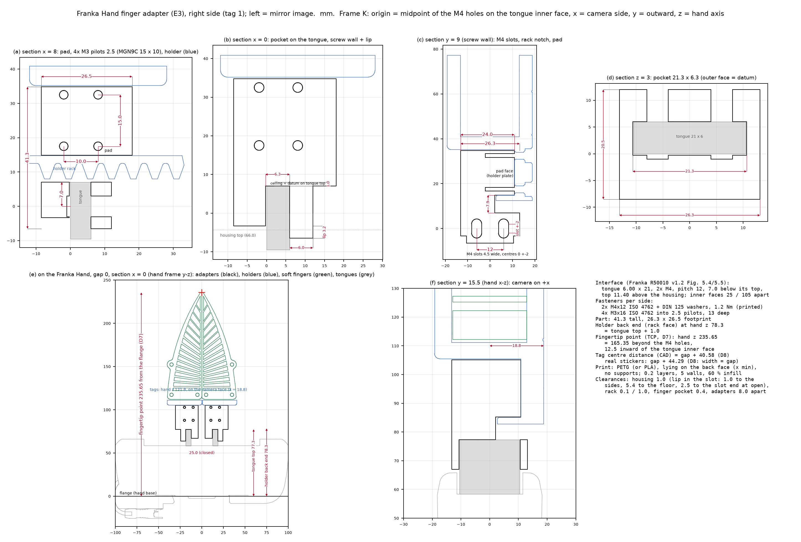

# Finger adapter: UMI finger holders on the Franka Hand (E3)

One printed part per finger. It puts the same soft fin-ray fingers we trained with, in their UMI finger holders with
the ArUco tags, on the Franka Hand's finger carriers. The same part is in the sim kit, so the sim's fingers, tags and
TCP match the real ones.



## How it works

- **Carrier side.** A cap over the carrier tongue (6.00 x 21 mm). The pocket ceiling rests on the tongue top, which
  sets the height. Two M4x12 go through the outer wall into the tongue's M4 holes. The outer wall bears on the tongue's
  outer face. The holes are slots, +-2 mm along the hand axis (D4), so they fit whatever the hole height turns out to
  be. The bottom stays 1 mm above the housing. Only the screw wall dips into the housing's finger slot, as the stock
  fingers do.
- **Holder side.** A pad takes the place of the handheld gripper's MGN9C carriage. The holder plate sits on it and is
  held by its own four counterbored holes (15 x 10 mm), with M3x16 screws threaded into the print. The holder's rack,
  at its back end, rests on the pad's lower face.
- **Why the fingers sit where they do.** The holder's rack spans the tongue, so the rack has to clear the tongue top
  (by 1.0 mm). That sets the fingertip height, not the adapter: the fingertip point is **235.65 mm from the flange**.

## Key numbers

| | Value | |
|---|---|---|
| Fingertip point (TCP), hand frame | (0, 0, 235.65) mm, the same at every gap | D7: `F_T_TCP` z = 0.2357 m |
| Fingertip vs its carrier | 12.5 mm inward of the tongue inner face, 165.35 mm beyond the M4 holes | |
| Holder back end (rack face) | hand z 78.3 (tongue top 77.3 + 1.0) | |
| Tag centre distance | CAD outline: gap + 40.58 mm; real stickers (and the sim kit): gap + **44.29 mm** | D8 (E7): training's width = tag distance − 44.3 mm = the **fingertip gap**; `width_offset_m` 0 |
| Adapter | 41.3 tall, 26.3 x 26.5 footprint, 19.7 cm3 (25 g as solid PETG) | |
| Each finger assembly | about 130 g as solid parts (adapter + holder + soft finger + screws); weigh the prints | |
| Clearances | housing 1.0 mm (in the slot: 1.0 to the sides, 5.4 to the floor, 2.5 to the slot end when fully open); adapters 8.0 mm apart and fingertips touching at gap 0 | |

Every number with its source is in [adapter.yaml](adapter.yaml), which the script writes.

## Files

| File | What it is |
|---|---|
| `adapter.py` | Parametric CAD (cadquery). Every interface number is a named parameter with its source. Writes everything below. |
| `drawing.py` | The dimensioned drawing (`out/drawing.png`, `.svg`), called by `adapter.py`. |
| `out/adapter_{left,right}.step`, `.stl` | The parts in the Franka Hand frame (mm) at gap 0, camera on +x. `left` carries the tag-0 holder (hand -y); `right` carries the tag-1 holder (hand +y). They are mirror images. |
| `out/adapter_{left,right}_print.stl` | The same parts, lying on their back face, ready for the slicer. |
| `adapter.yaml` | The fingertip point vs gap, the TCP z offset (D7), the tag distance (D8), masses, clearances, and all parameters. |
| `kit_franka_v1/` | The sim finger kit (`finger_kit/v1`): the soft fingers, the holders and this adapter. |
| `smoke_sim.py` | Mounts the kit on franka_sim's Panda, checks the contact geometry and renders the hand. |

Regenerate: `~/envs/sim_cad/bin/python -I sim_deploy/adapter/adapter.py`, then
`MUJOCO_GL=egl ~/envs/env_sim/bin/python sim_deploy/adapter/smoke_sim.py`. The `sim_cad` env is python 3.11 with
`cadquery` 2.8, `trimesh`, `rtree`, `scipy`, `matplotlib` and `pyyaml`.

## Before printing: caliper checks on the real hand

The manual's Fig. 5.5 gives 15, 8 and 11.40 mm without clear reference lines. Read against Franka's own hand meshes,
they mean: the hole centres are 7.0 mm below the tongue top (15 - 8), and the tongue top is 11.40 mm above the housing
top. The meshes agree to 0.1 mm. Take the stock fingers off and measure:

1. **Tongue top to the M4 hole centres: expect 7.0 mm.** The slots fit 5.0 to 9.0. Outside that range, change
   `Franka.hole_below_top` and reprint.
2. **Flange face (where the hand meets the arm) to the tongue top: expect 77.3 mm.** This sets the TCP:
   TCP z = this + 1.0 + 157.35. Fix `Franka.housing_top_z` (77.3 = 65.9 + 11.40) if it differs.
3. Housing top to the tongue top: expect 11.40 mm. Tongue thickness: expect 6.00 mm. Width: expect 21.0 mm.
4. Gripper closed: expect the tongue inner faces 25.0 mm apart. Fully open: 105 mm. If the closed distance differs,
   the fingertips either press together before the stop or keep a gap.
5. For D8, on the holders: the real stickers sit ~2 mm further out than the engraved outline (E7, measured in the
   gripper calibration: tag centre 22.3 / 22.5 mm from the holder seam, CAD 20.0 / 20.6). Training's width is the
   fingertip gap (umiproc subtracts the closed tag distance), so after homing the hand must read ~0.000 with the
   fingertips touching: check that, and keep `gripper.width_offset_m: 0`.

## Print

- PETG (PLA also works). 0.4 mm nozzle, 0.2 mm layers, 5 perimeters, 5 top and bottom layers, 60 % gyroid infill (or
  100 %: the part is small).
- Use `adapter_*_print.stl`: the part lies on its flat back face and needs no supports. The pocket roof is a 6.3 mm
  bridge, and the M4 slots are horizontal holes 4.5 mm wide.
- In this orientation the layers run along the bending load from the fingertip (the hand axis), and the M4 screw axes
  lie in the layer plane.
- Check after printing: pocket 21.3 x 6.3 mm, slot width 4.5 mm, M3 pilots 2.5 mm. Clean the pocket so it slides over
  the tongue without force.

## Hardware (both fingers)

| Qty | Part | Where |
|---|---|---|
| 2 | printed adapter, one left and one right | |
| 4 | M4x12 ISO 4762, steel 8.8 or A2 (the manual's screws) | adapter to tongue |
| 4 | M4 washer, DIN 125-A (9 x 0.8 mm) | under the M4 heads, over the slots |
| 8 | M3x16 ISO 4762 | holder to adapter, through the holder's counterbores |
| 2 + 2 | UMI finger holders with tags 0 and 1, soft fingers, and their M3 screws | unchanged from the handheld gripper |
| | Medium threadlocker (e.g. Loctite 243) | M4 screws |

## Assembly

1. Take the stock fingertips off: 2 M4 screws each.
2. Holder onto the adapter: put 4 M3x16 in from the tag side, through the holder's counterbores, and drive them into
   the pilot holes. Tighten snug, about 0.5 Nm, so they don't strip. The holder's rack should rest on the pad's lower
   face. **Tag 0 holder on `adapter_left`, tag 1 holder on `adapter_right`.**
3. Slide the adapter down over the tongue until the pocket ceiling rests on the tongue top. Both tags face the camera
   side of the hand. Seen from the camera, the tag-0 finger is on the left of the image.
4. Put 2 M4x12 with washers through the slots, from outside, into the tongue. Hold the ceiling down on the tongue
   and tighten to **1.2 Nm** with threadlocker. The manual's 2.25 Nm is for metal fingers and would crush the printed
   wall.
5. Close the gripper slowly. The soft fingertips should just touch, with the holders 0.6 mm apart and the adapters
   8 mm apart. Open it fully: nothing should touch the housing.
6. **Run gripper homing (libfranka `Gripper::homing`).** The hand recalibrates its width for the new fingers.
   The reported width is then the fingertip gap.

## Loads (read before grasping)

The manual says the Franka Hand is "designed and tested for a finger length of 54 mm". Gripping far from the hand
causes tilting loads. These fingertips are 165 mm beyond the carrier screws, about 3 times the tested lever. A 30 N
grasp puts about 5 Nm on each carrier; stock fingers would put 1.6 Nm.

- Keep the grasp force at or below about 20 N. The eraser weighs 30 g and needs far less.
- Avoid side loads and collisions on the fingertips.
- Set the payload for about 0.26 kg of fingers in place of the stock fingers' 0.03 kg. That is the solid estimate;
  weigh the parts.

The adapter itself is short and stiff: a 15 x 26 mm spine. At 70 N its bending stress is about 10 MPa.

## Sim

`kit_franka_v1` uses the `iphumi_umi_soft_v1` fingers and holders unchanged, plus `adapter_{left,right}.stl`. Every
mesh is in the holder CAD's frame. `kit_T_M` is the menagerie jaw mount J, so the station tooling uses:

```yaml
finger_adapter:
  mode: kit
  kit: ../sim_deploy/adapter/kit_franka_v1        # relative to controlSW/
  kit_sha256: <adapter.yaml sim_kit.kit_sha256>
  adapter_length_m: 0.0                           # no placeholder block: the real adapter is in the kit
  lateral_offset_m: 0.0
  adapter_yaw_deg: 0.0
tcp_x_along_hand: "+y"                            # camera on hand +x
```

franka_sim's `_mount_kit` then names the parts `pad_{l,r}` (soft fingers), `finger_holder_{l,r}` (holders),
`finger_holder_{l,r}_1` (adapters) and `tag_{l,r}`. It places the TCP at the fingertip point (235.65 mm) and folds
the part masses into the finger bodies. Run `smoke_sim.py` for the checks and the renders.
